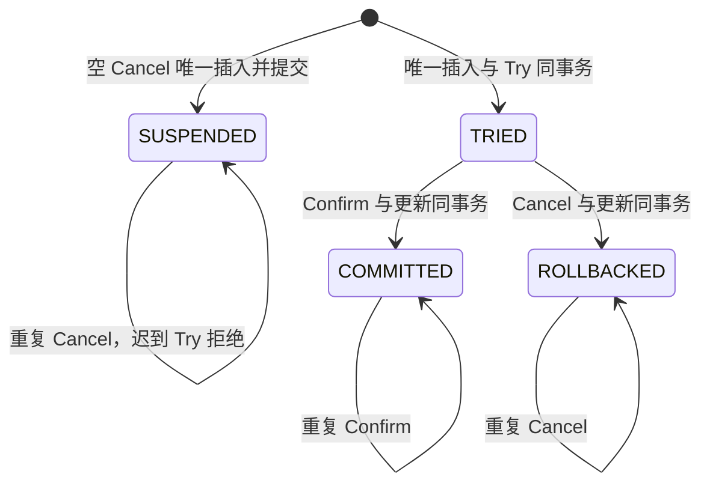

# Phase 4：TCC 与持久 Fence

事实源延续 [总架构计划 Phase 4](../architecture/SEATA_RUST_ARCHITECTURE_PLAN.md#phase-4xa--tcc)，固定 Java `cba73e180fd8896a99df6415b859d275122feaa7`。本变更不扩展 MySQL AT 的 V1 发布声明；TCC 只有完成下述执行、持久化、正式 TC 和故障门禁后才可声明支持。

## 核心与兼容行为

独立 `seata-tcc` 承载 `BusinessActionContext` 和 Fence 决策。TC 原 XID、BranchId 和精确资源名来自原登记/回调，不接受应用数据覆盖。外层应用 JSON 的 `actionContext` 对象包含业务参数；Java 的 null、缺失和空白应用数据构造空上下文，缺失或 null 的 actionContext 同样为空。非对象 actionContext 和非法 JSON 拒绝。只有 JSON 布尔 true 的 `useTCCFence` 启用原标志，不把字符串或数字转成 true。动态上下文更新与 BranchReport 必须另行实施，不通过解析器冒充已支持。

参数保存为已验证的原 JSON 值字节，避免把 Java long、任意精度整数/小数或指数先转 f64 后损坏。字符串键保持 JSON 解码语义；同键按原 Java parser 的最后值处理。输入总字节有界、嵌套解析有界；Debug/错误不能带业务值、原 XID 或资源文本。

Fence 固定码为 TRIED=1、COMMITTED=2、ROLLBACKED=3、SUSPENDED=4；未知码拒绝。Try 只允许唯一插入 TRIED 后执行业务，任何已有记录都不能重复 Try。Confirm 仅 TRIED 可原子迁移 COMMITTED 并执行；COMMITTED 返回已完成；缺失保持失败，ROLLBACKED/SUSPENDED 不换向。Cancel 对缺失记录唯一插入 SUSPENDED 并跳过业务，对 TRIED 原子迁移 ROLLBACKED 并执行，对 ROLLBACKED/SUSPENDED 复用完成，对 COMMITTED 不换向。

核心决策仅描述持锁事务内应执行的动作，不证明提交成功、TC 授权或缺行已被围栏。缺行 Cancel 的成功必须等 SUSPENDED 唯一插入与提交确认；并发 Try 胜出时重新读取，不能凭一次缺行查询宣布空回滚。

## 实施与完成门禁

1. 固定原 Java 上下文/常量执行向量，双 Rust 差分、全部 Fence 状态/动作与损坏输入测试。
2. 正式 TCC Resource 注册、原回执交接、RM apply/recover，Try/Confirm/Cancel 显式业务契约。
3. 显式 MySQL Fence 与业务同事务；方向、原身份、实例与当前物理结构校验；取消、回包丢失和持久恢复。不能仅靠内存状态或文件日志宣布业务已完成。
4. 实际唯一键竞态、空回滚、迟到 Try、幂等、并发、旧未知结果恢复及进程/数据库故障。
5. 固定原 Java TC 整笔 Commit/Rollback、重复回调与重连、上下文参数核对；双版本回归与独立 SQL/原始协议证据。
6. 动态参数报告、生产权限、清理保留策略、负载与运维另行完成，不能删除 Fence 后允许原身份再次 Try。

第 1 项核心增量已取得 [固定执行与源码反例证据](../phase-4/evidence/tcc-core/README.md) 和 [machine ledger](../phase-4/tcc-core.json)：原 Java 实际 21 项上下文、4 个 Fence 码，双 Rust 每版 6 项组件测试/63,488 个 BMP 标量/15 格 Fence 矩阵，七类源码反例每版实际七次行为失败。完整工作区各 791 passed / 372 ignored，TCC/XA/MySQL 严格 Clippy 通过。该结果不证明数据库 Fence；第 2–6 项及全部计划继续开放。不创建第二套 Spec Kit/OpenSpec 事实源。

## 正式登记与 MySQL Fence 执行

显式 `tcc` feature 使用独立 `seata_rs_tcc_fence_v1`，不改变 Java Undo、原 Fence 表或 AT/XA 表。列为原 XID/BranchId、精确动作资源名、原可选应用数据、原实例 UUID、schema_version 和 Fence status，主键为原 XID/BranchId。运行时不建表、不迁移、不删除终态。XID 当前限定非空 UTF-8 至多 128 字节，资源名至多 512 字节，应用数据沿用核心预算；超限在正式登记前拒绝，不截断或 hash。

业务以 `TccBusinessAction` 显式提供 Try/Confirm/Cancel，接收原上下文及仅允许当前有界参数化 DML 的事务能力。该能力不暴露原连接、COMMIT、DDL 或内部表写入；每次 DML 持 MDL 检查当前 InnoDB、触发器与双向外键。失败或取消后作用域封闭，即使业务捕获错误也不能继续或提交。业务返回 false/错误时 Fence 和同库业务一起回滚；外部网络、其他数据库或应用自行产生的副作用不由本地事务能力协调。

Try 必须持正式 ResourceClient 单次成功登记签发的原回执，原模式为 TCC、lock_key=None，原 actionContext 带布尔 useTCCFence=true。唯一插入 TRIED 与 Try 业务同事务提交，已有 Fence 不得重复执行。登记、数据库失败或期限必须保留已取得的原回执；未知登记不合成编号、不重发登记，未知提交不盲重试业务。

Try 错误按 ADR-0008 区分：Refused 表示本次未发送 COMMIT，不否定其他尝试已有的 Fence，也不授权重放；UnknownCommit 表示本次提交命令可能已发送而响应未确认；Deadline 单独保留登记和 Try COMMIT 的发送边界。提交边界只在最终实例/持久性检查之后、即将发送原 COMMIT 前置位，取消不能回退该事实。

RM apply/recover 都先核对当前物理表、持久原身份和实例；在持原行锁的同一事务中比较 TRIED、写原终态并调用对应业务。未知旧尝试只能在同一原行锁排除旧事务、核对真实状态后恢复；已持久同方向终态只返回 Applied，不重复调用业务。相反终态、Confirm 缺行、身份/结构冲突或驱动失败保持 Pending/失败，不能猜成功或换向。

空 Cancel 仅由正式连接产生的不可伪造 BranchCallbackReceipt 经 Pending 之后的 observer 入口仲裁。缺行时唯一插入 SUSPENDED 并确认提交，随后 apply/recover 才能复用该终态。手工裸身份 apply/recover 不能创建空回滚屏障；并发 Try/Cancel 靠原唯一键和行锁仲裁，任何死锁/重复键/未知提交均保留未决，由原 TC 重试同一身份。迟到原登记回执不能穿过已提交 SUSPENDED。

本增量选定实现已取得 [正式 MySQL TCC 验收证据](../phase-4/evidence/tcc-managed/README.md) 和 [machine ledger](../phase-4/mysql-tcc-managed.json)：双版本每版六项真实 MySQL、两项原 TC 全局事务，覆盖实际行锁等待、空 Cancel/迟到 Try、五类身份与四类结构拒绝、三阶段 COMMIT 原 OK 丢失和旧 Pending 恢复，无业务 DML 重放；134 项证据削弱拒绝。工作区各 791 passed / 380 ignored，严格检查通过。完整登记/TC 故障矩阵、进程/数据库恢复、动态报告和生产保留/权限/负载仍未完成，不能据本增量关闭第 2–6 项全部门禁或总计划。
