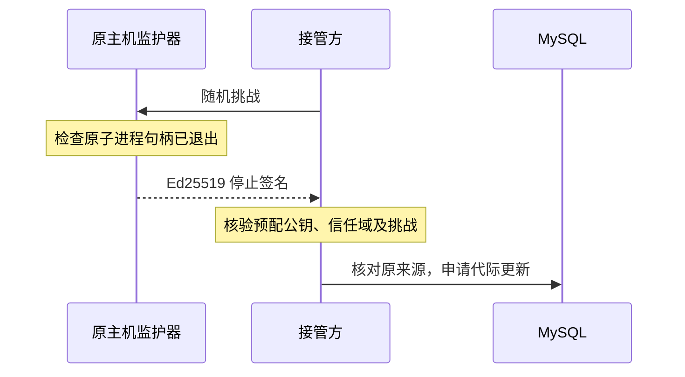
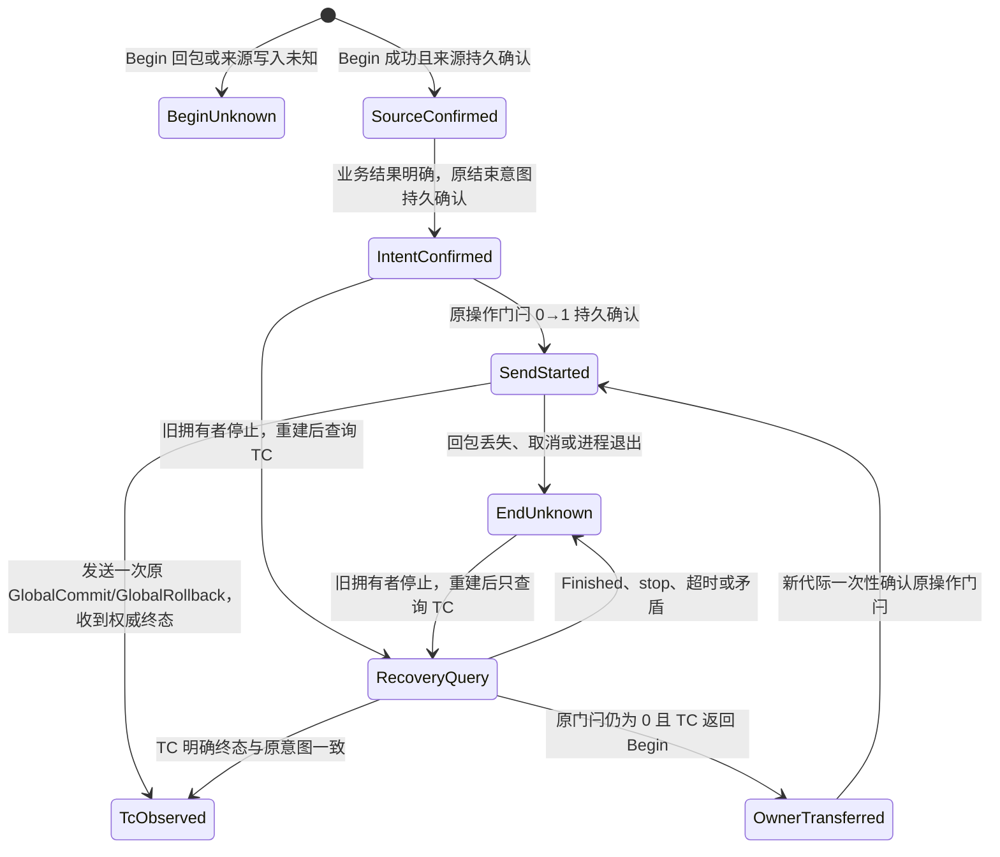

# TM Launcher 跨进程恢复设计（实施中）

依据[一阶段提交契约](mysql-first-phase-commit-contract.md)与[V1 验收清单](../phase-0/v1-implementation-acceptance-checklist.md)。当前 `seata-tm` 的 `recover_unknown` 凭证绑定原 `TransactionManager` 的内存身份，`participant(xid)` 只可查询或参与；本设计不改变这两个已验证的权限边界。RM 006/007 行也不作为 TM 来源。

## 持久来源与信任边界

独立的 008 表只由实际发出且收到成功 `GlobalBeginResponse` 的 TM 写入。写入必须在应用接收 Launcher 句柄、开始业务副作用之前持久确认；写入结果未知时不执行业务，保留 TC 事务等待原 TC 超时。来源包含原 XID 全字节、其 SHA-256 索引、TC 数值端点、应用/服务组身份、Begin 响应异常码与可选 `extra_data`、业务意图标识、保守事务期限、拥有者代际、由操作系统随机数生成的 TM 实例 ID 和创建时间。实例 ID 绑定实际签发该 Launcher 的管理器；查询可读，但本身不是旧进程已停止的证明。来源表不能由公开 XID、RM 回执或可读错误诊断直接构造。数据库权限必须把来源写入与只读查询分离；若调用方可任意写此表，就不能认为该表授予 Launcher 权限。

实例 ID 由增量 009 迁移加入，列允许 `NULL` 以保留既有 008 行。历史行的 `NULL` 表示没有可验证实例身份；只读快照须拒绝，所有新的意图和发送门闩 CAS 都必须带实例 ID，因此历史行不能被新 TM 接管或补发。正式 Begin 路径始终写入非空 32 字节 ID。009 不追填或猜测旧实例身份。

XID 可达原生 `string16` 上限，故表用 32 字节摘要作唯一索引、用 `MEDIUMBLOB` 保存原 XID；读取和 CAS 前必须逐字节比较，摘要相同但原文不同一律拒绝。业务意图是调用方提供的非敏感、稳定标识，不存业务载荷或凭据。所有身份字段保持原始字节，不 trim、不改写。固定的 128 字节 RM 006 XID 存储上限不得反向缩小 TM 原生 XID 契约。

恢复前可提供只读来源快照：必须先按 SHA-256 摘要定位，再核对完整原 XID，并验证端点、应用/服务组、业务意图、代际、原操作和发送门闩形状。返回的快照只供核验与观测，不携带任何结束或代际更新能力；不存在的摘要返回无记录，同摘要而 XID 不同或字段损坏返回冲突。期限是否已过应由同一 MySQL 服务端时钟判断，不能依赖新进程的本地墙钟。快照本身不得构造 Launcher。

读取新快照后，`query_original_tc` 核对调用方业务意图、数据库在快照读取时判定的期限，以及管理器配置中的原 TC 端点、应用、服务组，再向原 XID 发送一次状态查询。接口保留 TC 原状态与拒绝语义。`Finished` 继续保留为 `Finished`。快照中的期限是读取时的采样，受信接管仍须在数据库 CAS 中重新核对当前期限。

### 本机旧进程停止证明

受信控制进程使用 `LauncherProcessMonitor` 启动固定的工作程序，并保留原始子进程句柄。子进程在开放业务前调用 `announce_supervised_instance`，将唯一管理器实例 ID 写到由监护器持有的专用输出管道。监护器从管道读取有界报告，并在操作系统确认同一子进程退出后才签发 `StoppedLauncherOwner`。控制进程必须通过原监护器验证签发者，并比对数据库来源的实例 ID。缺少报告、查询失败或进程仍活着时无法生成可验证证明。

该能力依赖控制进程选择并信任工作程序及其启动参数。每个受管子进程只报告一个 TM 实例，业务日志走 stderr。当前证明只在监护器所在进程中可核验。控制进程及其原监护器失去后，须使用独立的可信停止证据。

### 本机代际申请

在部署管理员执行 [接管角色 SQL](../../crates/seata_db_mysql/sql/tm_launcher_recovery_role.sql) 后，专用接管账号启用 `seata_tm_launcher_recovery` 为默认角色。该角色可读来源，并可更新拥有者 ID、代际、信任域及修改时间。受信控制进程将原监护器和停机证明交给 `transfer_stopped_owner`，只在原结束意图存在、门闩为 0、原 TC 返回 `Begin` 时申请。MySQL 事务先锁住来源行，再用新语句核对数据库当前期限、完整来源、原实例、原代际、原结束意图及发送门闩。确认提交后返回一次性的新代际句柄。原 TC 的其它状态原样返回给调用方。

恢复控制方使用 `build_with_recovered_end_authority` 创建管理器及与实例绑定的发送权限。调用 `finish` 时消耗代际句柄并提供该权限及写角色连接。实现比较接管和写角色配置的 JDBC 资源标识，重新查询原 TC，并仅在 `Begin` 时尝试发送门闩。同库事务锁住来源行后用数据库当前时钟核验期限，CAS 核对原 XID、新实例、新代际和原结束意图。只有提交确认后才发送一次原 Commit 或 Rollback。回包丢失保留未知，写后的发送标记继续阻止重复发送。恢复控制方应保管实例权限并只使用受信存储适配器。

### 可跨主机传输的停止签名

部署控制面须把原实例映射到原主机的受信监护器公钥和 32 字节信任域。信任域由部署配置按签发主机与环境分配，公钥不从对方回包读取。签发主机的 `LauncherStopSigner` 独占 Ed25519 私钥，只能由持有匹配退出证明的原监护器签署。接管方用 `LauncherStopVerifier` 为持久来源实例及申请接管实例生成随机挑战，使用本地单调时钟限制挑战期限，最长 60 秒。可传输数据为 32 字节挑战及 64 字节签名，签名覆盖固定用途前缀、信任域、随机挑战与旧实例 ID。

010 迁移增加可空的 `owner_stop_scope`。工作进程由部署配置通过 `TransactionManagerBuilder::launcher_stop_scope` 指定本节点信任域，正式 Begin 将它随实例写入来源。接管控制面按数据库来源的信任域查找预配公钥和 TLS 配置。远程申请须匹配该域，持锁更新还会与来源旧域逐字节比较，并把新拥有者的信任域和实例一起写入。发送门闩校验当前实例与域。已有来源保持 `NULL`；仍可通过原监护器本机接管。启用有域事务前，部署须先执行 010、升级既有角色的[列权限](../../crates/seata_db_mysql/sql/tm_launcher_stop_scope_upgrade_grants.sql)，并更换所有拥有接管权限的运行时实例，避免旧实现继续按未绑定来源的规则受理请求。

从 009 升级时，以部署管理员选定现有 Launcher 数据库后执行增量授权脚本。该脚本对原写角色增加信任域列的 `INSERT`，对原接管角色增加该列的 `UPDATE`。既有账号、默认角色和 009 来源无需重建。若其中一次授权执行失败，修正后在同一 Launcher 数据库重新执行该授权脚本。部署使用自定义角色名时，应将两条授权指向对应的既有角色。

受信控制面把签名、原验证器及其未过期挑战交给 `transfer_attested_owner`，核验成功后进入同一代际 CAS。多个申请即使收到相同签名，也须逐行满足原代际 CAS。

`LauncherStopExchange` 在部署方提供的认证字节流上运行。一条连接只执行一次交换，成功或失败后均由调用方关闭连接。请求为 ASCII `SST1`、32 字节旧实例 ID、32 字节挑战；应答为 ASCII `SSR1` 和 64 字节签名。签发方在核对原监护器退出证明与请求实例后才写应答，接管方只返回已用预配公钥验证的签名。请求受挑战剩余时间与读写总预算中较短者约束；错误头、截断或超时均失败。监听、连接和对端认证由部署控制面提供，例如通过已配置的双向 TLS 流。库不在网络上查找或接收验证公钥。

接管方解析并校验预配 Ed25519 公钥，使用严格签名验证。弱公钥无法授权接管，含无效公钥的轮换请求会被拒绝，当前可信清单继续有效。签发侧保留已有的 PKCS#8 和线缆格式。 [Ed25519 严格验证 API](https://docs.rs/ed25519-dalek/2.2.0/ed25519_dalek/struct.VerifyingKey.html#method.verify_strict)

接管方从可信主机清单取源主机的停止签名公钥、信任域、TLS 主机名和允许的 TLS 证书指纹，再为目标 TM 实例生成挑战。原主机在保护停止签名私钥的监护进程中持有退出证明。停止签名密钥与 TLS 身份密钥独立配置。

Rust 提供 `LauncherStopTlsClient` 与 `LauncherStopTlsServer`。接管方与签发方各提供 CA 信任根、本方 DER 证书链与私钥、对端叶证书 DER 的 SHA-256 指纹列表。客户端还须配置签发方证书上的主机名。适配器只启用 TLS 1.3 和 `seata-tm-stop/1` ALPN，要求客户端证书，关闭会话恢复，并在证书链验证后检查对端指纹。应用层请求与应答沿用同一个传输预算，客户端同时受挑战有效期限制。调用方负责监听、连接及并发接纳。客户端证书要求由 [Rustls 的 WebPKI 客户端验证器](https://docs.rs/rustls/latest/rustls/server/struct.WebPkiClientVerifier.html)执行。

#### 停止签名公钥轮换

部署控制方使用 `LauncherStopVerifier::new_rotatable` 创建验证器和单独的 `LauncherStopKeyRotation` 权限。先通过可信配置把新公钥加到当前信任清单，形成一旧一新的重叠期；再切换原监护器的签名器；确认切换后，将接管方清单替换为只含新公钥。清单更新是原子的，空清单、重复公钥与超过两把公钥的配置会被拒绝。挑战继续绑定原验证器实例与信任域，每次验证都读取当前清单。MySQL 在查询 TC 前及取得来源行锁后复验签名与挑战期限；通过最终核验后已开始的提交按既有 CAS 规则处理。

当前夹具验证了独立进程与回环 TCP、双向 TLS、停止签名公钥轮换及交换结果进入 MySQL 接管。双容器节点夹具在 Docker 内部网络运行 Linux 签发和接管进程，凭证分角色注入，停止签名私钥留在签发节点。

联合 AT 夹具另由 Linux 签发容器监督旧 TM/RM，Windows 宿主运行接管 TM/RM。签发容器的回环中继保持两侧配置中的原 TM、RM 和 MySQL 数值端点一致，并将请求转给宿主运行的固定 Java TC 帧观察器及真实 MySQL。独立发布在宿主回环的签名端口要求双向 TLS。接管进程用预配公钥核验远程证明，再申请代际并发送原结束操作。该夹具验证容器与宿主边界，分离的物理或虚拟机、证书配置管理系统接入和生产网络验收继续开放。

## 结束状态与发送门闩

新部署在运行 008 至 010 后，选定 Launcher 数据库并一次性执行 [角色 SQL](../../crates/seata_db_mysql/sql/tm_launcher_roles.sql)。使用专用账号，分别用 `GRANT 'seata_tm_launcher_writer' TO 'tm_runtime'@'app-host'` 和 `GRANT 'seata_tm_launcher_reader' TO 'tm_observer'@'ops-host'` 授权，再对各账号设置相应的默认角色。账号与主机名按环境替换，并检查这些账号的直接授权和继承角色。写角色允许正式 Begin 插入的列和结束 CAS 更新的列。掌握写账号的调用方属于可信 TM 边界，因为列授权允许向结束列直接写值，单向状态转换由正式存储层的 CAS 保证。读角色仅能 SELECT Launcher 表。角色名在服务器上共享，同实例部署多套环境时使用各自的角色名，并逐个数据库核验授权范围。

`end_operation` 只能从无值单向确定为 Commit 或 Rollback，且在业务结果已明确后持久确认。`send_started` 只能从 0 单向变为 1，并须在任何 GlobalCommit/GlobalRollback 网络发送之前以独立事务持久确认。CAS 同时核对摘要、完整 XID、原 TC/应用身份、TM 实例 ID、原操作及拥有者代际；受影响行数必须恰为 1。控制事务回包未知时不得发送；重新读取到 1 也不得发送第二次。未知网络结果、取消、进程退出及重建均不得把门闩清零。TC 负责事务重试。

新进程只有在旧拥有者**已停止**的证据成立后才可申请新的拥有者代际；单纯租约超时或心跳缺失不是该证据。必须先核对同一来源、期限与业务意图，再查询原 TC。无结束意图不能补发；有结束意图且发送门闩仍为 0 时，仅可按同一原操作显式进入一次发送门闩；门闩为 1 时只能观察，不能重新发送。`Finished`、重试超时、stop、查询失败或状态与意图冲突都保留未知并转运维核验，不能推断历史提交成功。

## 验收顺序

1. 在独立 MySQL 8.4.13 上验证 008→009 迁移的原 XID 大小、身份列、原操作单向约束、发送门闩及行锁 CAS；同摘要不同 XID、不同应用/端点、损坏、旧 `NULL` 实例或过期记录须失败关闭。
2. 将正式 TM 的 Begin 成功路径接入持久来源；来源写入失败/回包丢失时不运行业务。原普通 TM API 保持现状。
3. 将 Commit/Rollback 接入意图与发送门闩；注入门闩 COMMIT 回包丢失、标记后发包前退出和发包后丢响应，证明没有二次结束帧。
4. 实现受信接管与状态查询，并用两个独立 TM 进程、固定原 Java TC 和原始帧观察器验证期限、权限、冲突、Finished/stop 及业务终态。只有这些证据齐备才评估 WP05/WP06 的 TM 重建子项。

## TC 传输信任来源绑定（实施基线，2026-11-27）

TLS 管理器的持久 Begin 来源必须保存同一 TC 信任配置的 SHA-256 摘要。摘要具有独立版本域，绑定 TLS 1.3/mTLS profile、规范化预期 DNS/IP SAN 和排序去重后的显式 DER 信任根集合；不包含客户端证书/密钥或服务端叶证书，使已授权新节点可使用独立客户端身份，且同一信任根/SAN 下的叶证书续期不改变来源。摘要是配置一致性检查，不授予观察、接管或结束权限。

014 增加 transport_binding 可空 BINARY(32) 并调整来源版本约束：旧明文来源保持 schema_version=1、NULL 绑定；新 TLS 来源使用 schema_version=2、非空绑定。旧运行时只接受版本 1，不能接管版本 2。旧明文来源及未执行 014 的旧 schema 保持可读写；TLS Begin 在 014 缺失时持久化失败，不交付业务 Launcher，也不自动发送结束，原已创建 XID 保留于原持久化错误供 TC/人工处理。

新快照读取须在同一行结果内核对版本与绑定：版本 2 的字段缺失、NULL 或长度损坏均拒绝，不退回明文。查询原 TC 前逐字节比较当前管理器绑定，TLS→明文、明文→TLS、根集合或 SAN 改变均在任何 Status/结束请求前拒绝。原拥有者意图/发送更新、持锁接管及恢复发送 CAS 还必须核对相同版本和绑定，阻止快照读取后绑定被替换的竞态。014 只授予写角色 INSERT(transport_binding)，接管角色不得 UPDATE 该字段；原停止证明、实例权限、期限、代际及不可重发门闩保持原义。

验收要求真实 TLS/MySQL 来源、旧版本无 014 兼容、错误信任/降级零 Status 与结束发送、摘要/列损坏拒绝与恢复、持锁 CAS 竞态、受授权同信任接管、双工具链与固定原 TC 场景；信任根/SAN 的受控变更和完整生产证书运维仍需单独授权策略，不能隐式扩大信任。

上述选定验收已在 Rust 1.99/1.85 的真实 TLS/MySQL、真实旧拥有者退出与固定原 Java TC 场景通过；完整现场及负控见 [传输信任证据](evidence/tm-transport-binding/README.md)。迁移 014 后需由部署管理员执行新增列 INSERT 授权脚本；旧明文 schema 不要求该迁移。此记录不改变生产证书运维与完整 WP05–07 尚未关闭的状态。
