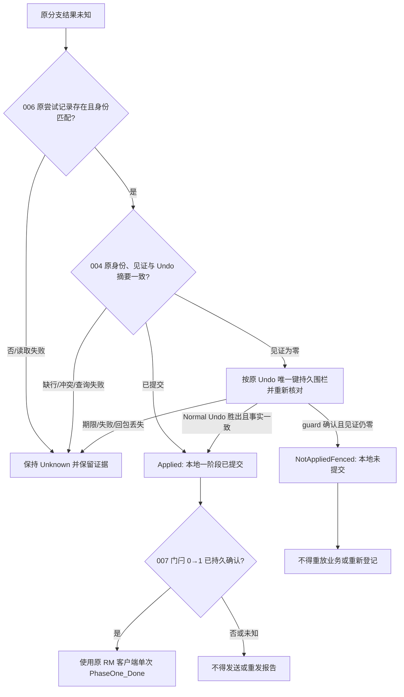

# Seata-Rust V1 能力矩阵与恢复操作指南（预发布，2026-11-26）

本文件按当前工作树和[原 V1 验收清单](../phase-0/v1-implementation-acceptance-checklist.md)列出可核验能力及故障时的安全动作。**尚无可声明为生产可用的完整 V1 配置**：WP05、WP06、WP07 和完整 WP00-R 仍开放。表中的“已验证”只适用于对应证据所写的原 Java TC 版本、工具链和测试环境。

## 能力矩阵

| 能力 | 当前状态 | 已有证据与实际边界 |
|---|---|---|
| 原生 Java V1 消息与帧 | 初期 peer profile 已验证 | [WP01](../phase-1/evidence/protocol-peer-profile/README.md)覆盖批准的类型和显式 Go 适配；原 Go 默认路径差异、完整 WP00-R 与外部 TC 风险未结。 |
| TCP 连接、登记、请求关联与回包 | 初期 peer profile 已验证 | [WP02](../phase-1/evidence/transport-recovery/README.md)含原 TC 响应丢失；生产 TLS/认证策略和端点发现仍开放。 |
| Rust TM Begin/Commit/Rollback、传播、同进程未知结果恢复 | 初期 TM profile 已验证 | [WP03](../phase-1/evidence/tm-gate/README.md)通过原 Java TC；`recover_unknown` 只接受原管理器的内存凭证，不能作 TM 跨进程 Launcher 接管。 |
| Rust RM 登记、分支报告、回调与持久状态 | 初期 RM profile 已验证 | [WP04](../phase-1/evidence/rm-gate/README.md)验证重复与重连；其资源动作夹具不证明 MySQL Undo 原子性。 |
| MySQL AT SQL/Undo 准备及真实数据库局部行为 | 实施与验证中 | [WP05 各增量](../phase-0/v1-implementation-acceptance-checklist.md#wp-05--mysql-at-phase-1)包含真实 MySQL 与固定 TC 选定场景；完整 SQL 支持矩阵、外部写入器锁覆盖和一阶段故障门禁未结。 |
| 无变化、无分支本地 COMMIT | 受限实现 | `MySqlCommitCheckedTransaction::commit_no_change` 仅允许无登记、无 Undo、无见证作用域；成功不证明有变化业务的 Undo 原子提交。见[提交契约](mysql-first-phase-commit-contract.md)。 |
| 有变化本地 COMMIT、原报告和跨进程 RM 恢复 | **默认关闭的实验特性** | `experimental_changed_commit` 下的 006 尝试记录、004 见证、007 报告门闩有[选定故障证据](evidence/mysql-commit-attempt-arm/README.md)。两个真正独立恢复者进程竞争已在[受控 RM 对端](evidence/mysql-report-process-race/README.md)与[固定原 Java TC](evidence/java-tc-changed-commit-report/README.md)的真实 MySQL 场景双工具链通过；持久 TM 接管已有[停止证明与原 TC 联试](evidence/tm-stop-nodes/README.md)，完整外部写入器准入和生产部署继续验收。 |
| Undo SHA-256 | 013 迁移的新版本行已验证 | 版本 4 的摘要与业务、Undo、见证同事务提交，独立恢复和正式回调拒绝改写。旧行保留 NULL 摘要及历史语义。[双工具链现场证据](evidence/java-tc-changed-commit-report/README.md#undo-sha-256-与同一分支恢复)。 |
| MySQL AT 二阶段补偿与幂等 | 选定实验配置十项已验证 | [WP06 验收项](../phase-0/v1-implementation-acceptance-checklist.md#wp-06--mysql-at-phase-2)包含原 TC、MySQL、幂等、回包丢失和断连证据。生产验收仍依赖 WP05 完整门槛。 |
| 生产可观测、部署配置、TLS/认证、负载与安全 | 未验收 | [WP07](../phase-0/v1-implementation-acceptance-checklist.md#wp-07--production-readiness)仍开放；[依赖审计](evidence/wp07-dependency-audit/README.md)仍报告 `rsa`。 |
| 其他 AT 数据库、XA、TCC、Saga、Rust TC | V1 范围外 | 按原[能力决策](../phase-0/v1-implementation-acceptance-checklist.md#5-v1-supported-feature-matrix)分别立项，不通过 MySQL AT 证据推断支持。 |

## 当前实验环境的恢复决策

恢复入口只接受**原 TC 分配的 XID、BranchId 与同资源 MySQL 管理器**。006 保存原成功登记身份但不签发新的 `RegisteredBranch`；004 保存本地一阶段见证；013 为新版本 4 恢复行保存原 Undo 字节的 SHA-256；007 的 `report_started=1` 仅表示报告**可能**已经发出。恢复不会授权重放业务 SQL、重新 BranchRegister 或由 RM 替 TM 发起全局结束。



| 可观察结果 | 操作动作 | 不可据此推断 |
|---|---|---|
| `MySqlCommitRecoveryOutcome::Applied` | 本地提交已确认；仅通过 `report_recovered_applied` 争抢 007 并报告，保留调用结果与 TC 帧。 | 不等于全局已 Commit、TC 已收到报告或二阶段已完成。 |
| `NotAppliedFenced` | 保留原 XID/BranchId、guard 与 004 证据；交由原 TC 的超时/决策路径处理。 | 不授权重做业务 SQL、重新申请分支或手工删 Undo guard。 |
| `MySqlCommitRecoveryError`、缺 006/004、查询或围栏结果未知 | 停止自动动作，保存错误和相关数据库事实；在恢复环境正常后可**重新观察原身份**。 | 见证零或缺行不能证明 COMMIT 未送达。 |
| `MySqlRecoveredReportError::AlreadyStarted` 或 `Claim` | 禁止再次发出报告；查询原 TC 状态和审阅 007/帧记录。 | `report_started=1` 不能证明 TC 收到报告。 |
| 原报告调用错误或响应丢失 | 保留原错误与已确认的本地事实；不自动重报。 | 不能把超时归类为 TC 明确拒绝。 |
| `DbError::UndoChecksumMismatch` | 保留原 XID、BranchId、版本、持久摘要和当前 Undo 证据，保持未知或让原 TC 重试。先处理存储完整性问题，再按原身份重新观察。 | 不授权报告成功、重放业务或用当前 Undo 重新计算并覆盖持久摘要。 |
| TM 结束结果未知 | 原管理器用原错误凭证查询。跨进程接管须读取持久 Launcher 来源、核验原所有者停止证明，再按 owner epoch 争抢结束权。使用已发送的结束标记时只观察原 XID。[停止证明与接管契约](evidence/tm-stop-nodes/README.md)。 | `Finished` 不证明历史 Commit，XID 也不是 Launcher 凭证。 |

操作时先冻结对应写入器的**新业务流量**，保存原始 RM/TM 帧、TC 状态、错误类别及原 XID/BranchId，然后只读核对数据库。对 006/004/007 的检查应使用绑定参数和只读权限；不要把凭据或原 `application_data` 写入日志。下列查询是核对字段的模板，`?` 表示由客户端绑定的原 XID 与 `branch_id`：006/004 的 VARBINARY XID 绑定 UTF-8 原字节，原 `undo_log` 的 VARCHAR XID 绑定原字符串；它不是可直接粘贴到 `mysql` CLI 的文本占位符：

```sql
SELECT HEX(xid), branch_id, HEX(resource_id), attempt_state, report_started
FROM seata_rs_at_commit_attempt
WHERE xid = ? AND branch_id = ?;

SELECT HEX(xid), branch_id, first_phase_committed,
       commit_authorized, commit_terminal
FROM seata_rs_at_branch_v1
WHERE xid = ? AND branch_id = ?;

SELECT xid, branch_id, log_status
FROM undo_log
WHERE xid = ? AND branch_id = ?;
```

应用 013 的环境还可查询下面的原分支摘要。旧表尚无此列，先确认迁移状态再执行。版本 1 至 3 的 NULL 摘要表示历史记录未承诺该完整性检查；版本 4 已提交且未终结的分支若摘要缺失，恢复保持未知。

```sql
SELECT schema_version, HEX(undo_sha256)
FROM seata_rs_at_branch_v1
WHERE xid = ? AND branch_id = ?;
```

只读检查不能替代 `recover_commit_attempt` 的原 Undo 唯一键围栏、身份校验和二次见证读取。不得手工更新 004/006/007、`undo_log` 或原 TC 锁表以制造预期状态。升级实验写入器前应停止并排空旧版本，按 001→007 顺序应用 AT 基础迁移，启用新摘要写入器前再显式应用 013；005/011 绑定、012 受信约束过程以及 008→010 TM Launcher 迁移按对应功能部署，详见[迁移目录](../../crates/seata_db_mysql/migrations)，核验目标 schema、InnoDB 与资源绑定；007 对旧 006 行默认置 1，故旧行不能被当作“尚未报告”。连接数据库时，`MySqlOptions` 默认 TLS VerifyIdentity；关闭 TLS 仅为显式字面 loopback 测试选项。固定原 Java TC 与 Rust 到 MySQL 的强制 TLS 和错误 CA 已有[现场联试](evidence/java-tc-changed-commit-report/README.md#mysql-tls-信任失败与原事务提交)，Seata 协议 TLS 及生产配置继续验收。

## 上线前仍需证明

WP05 的公开有变化 COMMIT、完整写入器准入、来源案例完整迁移，以及 WP06 对生产配置的最终验收。所测配置已验证提交/补偿、重复、响应丢失和持久 TM 接管，完整部署门槛继续开放；WP07 的可观测性、关闭策略、TLS/认证、负载与故障注入、安全审计（含剩余 `rsa` 公告）和部署配置；完整 WP00-R 与外部 TC 风险处置。完成每一项后，更新此矩阵的状态与证据链接，再评估生产发布。
