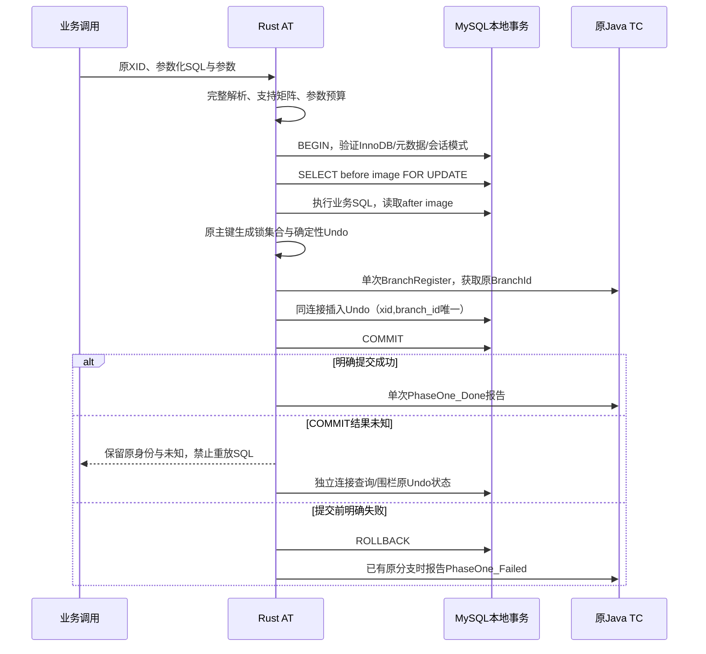

# WP05 MySQL AT 实施契约

状态：实施中；原[WP05十四项](../phase-0/v1-implementation-acceptance-checklist.md)与WP06不变。已有WP04首期控制面通过，不代表数据库能力完成。本文件细化既有架构/ADR-0004的执行步骤，不创建第二套规格体系。

## 固定边界与顺序

Java语义来源为`cba73e180fd8896a99df6415b859d275122feaa7`，Go工程参考仍为`82570d905919c1c66bb025a3a5979f25390de498`。生产源码沿现有snake_case目录，`seata_at`负责AT识别/镜像/Undo与状态，`seata_db_mysql`负责真实MySQL及SQLx调用。一个Java对象对应一个真实Rust文件，lib/mod只声明并重导出；不会用适配器声明或文件数代替交付。

先实现有界SQL识别及明确拒绝矩阵，再接入元数据与镜像、Undo与真实本地事务，最后正式RM/TC与提交故障验证。SQL识别通过不关闭“真实数据库原子性”验收项；完整Java模块的对象、测试和资产迁移仍需逐项对照，不能以首期SQL子集称为完整Java迁移。

上图没有在业务SQL前释放本地锁：before/after、业务与Undo保持同一连接/本地事务。分支登记必须发生在本地提交前；原申请未知时不得补造BranchId、再登记或提交本地业务。插入场景必须正确取得完整主键，不能猜测连续自增编号。

## SQL识别第一轮矩阵（数据库执行尚未认证）

| 输入 | SQL识别目标 | 真实执行附加门槛 |
|---|---|---|
| 单表INSERT，显式列，单行/多行VALUES | 接受；每行列数一致，记录原列与占位符数 | PK/默认值/生成值完整恢复，镜像与Undo同事务 |
| 单表UPDATE，普通列赋值 | 接受；有界确定性标量表达式及WHERE | 禁止更新PK；完整行镜像、类型与行数预算 |
| 单表DELETE | 接受；有界WHERE | 完整before image与补偿约束 |
| WHERE | 比较、AND/OR、IN常量列表、BETWEEN、IS NULL；仅本表标识符、绑定值或明确标量 | 排序/锁定完整PK集合，真实MySQL语义核对 |
| 算术赋值 | 本行列、绑定值、数值、NULL、单引号文本；明确算术运算 | 精确类型范围、计算结果与after image核对 |
| 单表 UPDATE/DELETE 别名及本表限定列 | 按[别名增量契约](mysql-sql-alias-contract.md)接受显式/省略 AS；拒绝无绑定前缀 | 前镜像 FROM 使用同一别名；真实表名保持元数据/锁/Undo 身份 |
| DDL、事务控制、CALL、SELECT、REPLACE、UPSERT、IGNORE、INSERT SELECT、RETURNING、CTE、子查询、JOIN/多表、跨schema、ORDER/LIMIT、函数/变量、注释及反斜线文本 | 明确拒绝，整句拒绝发生在数据库副作用之前 | 未通过新规格/测试前保持拒绝，不猜测执行 |

这不是永久删除后续能力；能力扩充须更新矩阵并证明镜像、锁和补偿正确。原完整架构仍包含其他SQL、数据库与ORM。SQL标识符第一轮限制为ASCII字母/数字/下划线/美元符号，首字符不为数字，最长64字节；保留大小写，拒绝重复列（按MySQL列名大小写规则）。占位符仅原生`?`，不能把字符串里的问号计入参数。整句UTF-8字节预算64KiB、有效token8192、运算符256、括号深度64、占位符/列/VALUES行/IN项预算1024、AST表达式深度32。字节/token/运算符/括号预算在构建AST前检查，防止扁平长表达式构造深树后才拒绝或析构溢栈；各预算同时生效。MySQL不支持的UPDATE FROM关键字显式拒绝，不能依赖上游AST恰好保留被消费的关键字。IN列表仅允许绑定值/常量表达式；不把解析器支持的任意语法自动视为AT支持。

## 驱动、数据与恢复门槛

MySQL部分无括号内建项在替代解析器中会被表示为普通Identifier；`CURRENT_USER/SESSION_USER/SYSTEM_USER/CURRENT_ROLE/CURRENT_DATE/CURRENT_TIME/CURRENT_TIMESTAMP/LOCALTIME/LOCALTIMESTAMP/UTC_DATE/UTC_TIME/UTC_TIMESTAMP`作为未引用表达式名显式拒绝。反引号引用的同名实际列可在后续真实元数据核对后使用，不能仅凭AST节点类型认定表达式确定。

解析器也可能消费`LOCAL`或`LIMIT ALL`而不在AST保留字段。通过支持矩阵后，必须将AST重建SQL再次词法化，与原有效token逐项比较；仅忽略空白、关键字大小写、同一词法不等号拼写以及允许的单个末尾分号。任何token丢失/新增均拒绝，不能只验证AST字段为None。`VALUES ROW(...)`当前未完成真实MySQL形状认证，明确拒绝；普通VALUES多行仍保留。

- SQL解析先使用已有公开缓存的`sqlparser=0.52.0`；仅复用其MySQL AST解析，不复用任意SQL执行承诺。SQLx候选为已有缓存`0.8.6`，需实际解析锁文件、依赖闭包和Rust1.85验证后才能成为正式MySQL依赖；不是“使用最新版”的声明。版本文档：[SQLx事务](https://docs.rs/sqlx/0.8.6/sqlx/struct.Transaction.html)。
- MySQL沿用已有固定镜像`sha256:a81d043930e51745522bd5c430961cf8286f0a23f0a9a2a6e0108f7ea71b0902`，真实启动后记录`SELECT VERSION()`、引擎、会话模式及事务隔离。自有随机库/容器与D盘数据目录，不修改共享数据库。
- schema先采用固定Java客户端`script/client/at/db/mysql.sql`的原始副本；新增Rust恢复记录若有必要则采用独立、版本化、明确迁移，不隐式覆盖原表。DDL不属于AT业务SQL，MySQL存在[隐式提交语句](https://dev.mysql.com/doc/refman/8.0/en/implicit-commit.html)，必须拒绝。
- 表元数据必须验证InnoDB、主键及列类型；触发器、生成列、外键级联、非事务引擎、未知类型和复杂默认值先拒绝。精确i64/u64、decimal、二进制、NULL和时间边界分别验证，不能经浮点或JSON-number丢精度。
- Undo有确定性序列化、版本/原身份/校验和与完整消费验证。Java parser上下文/资产对照未通过前，不声称可由Java RM读取Rust日志；这仍是待验证的兼容性要求，不以本地round-trip替代。
- `COMMIT`后断连不能按普通SQL错误报告明确失败。独立查询看到“无Undo行”也不能证明旧提交永不迟到；恢复需要持久围栏和唯一键仲裁。Java`GlobalFinished`防悬挂语义必须由真实并发/断连测试覆盖。
- 正式RM资源`recover`的`NotApplied`要求阻止所有旧尝试；取消Future、关闭调用或文件Pending记录不能单独提供数据库事实。TC负责事务重试，AT/RM不能自动重放业务SQL。

## 证据与剩余工作

### 首期 SQL 矩阵端到端补验

沿用上文已确认的语法边界，建立可执行矩阵，覆盖显式列及多行/混合参数 INSERT、原 WHERE 变化后的 UPDATE、单表 DELETE、六种比较、AND/OR、IN/NOT IN、BETWEEN/NOT BETWEEN、NULL 谓词、确定性算术和引号文本。每个接受用例须在双 Rust、原 TC 的提交及补偿两种决策下实际执行，独立核对预期业务、原登记和锁、同事务 Undo/checksum 与原 Java parser 读取。拒绝用例须区分识别拒绝与真实元数据/执行前拒绝。矩阵通过只证明已声明的首期范围，不扩大为完整 Java SQL 迁移或关闭全部 WP05 门禁。

[该矩阵已验证](evidence/initial-sql-matrix/README.md)：22 个接受、22 个语法拒绝、1 个真实元数据拒绝用例；双工具链分别完成接受用例的提交和补偿，共 88 笔全局事务。原 Java parser 重读全部 88 份正式 Undo，业务字段重编码一致。此状态关闭首期分类器/明确矩阵这一项，其他 WP05、生产准入及完整 Java 迁移要求保持原门禁。

固定原 Java TC 的跨表原子性及重叠锁批次并发登记已由 Rust 1.99/1.85 在真实 MySQL 上核对。两个 TC 数据库线程都写入独有键后才竞争公共键，失败方的独有锁随登记一起回滚。外部写入器准入及公开业务 COMMIT 门槛继续开放。[锁原子性证据](tc-lock-coverage-contract.md#重叠锁批次的并发登记)。

固定 Java AT 写入器现有可选事务准入入口。错误资源 ID、物理 UUID 或 Connector/J 映射在首条业务 SQL 前被拒绝。原 Java 与 Rust 读取同一 005/011 绑定，双版本实测匹配配置下锁竞争及锁释放。仍需验证生产权限和其他写入器。[准入证据](tc-lock-coverage-contract.md#java-写入器事务准入)。

固定 Java/Rust 互操作已验证分离 MySQL 写入账号和只读观察账号。Rust 的触发器可见性可由目标表直接授权证明，当前仍需全局 PROCESS。该现场覆盖实际 UPDATE、锁竞争、登记和回滚；其他业务 SQL 及生产元数据权限继续跟踪。[角色隔离现场](tc-lock-coverage-contract.md#分离写入账号的现场验证)。

固定 Java TC 的有变化 Rust 提交已通过分离账号反向竞争联试。006 表缺少直接可见授权时恢复拒绝，补授权后保留原提交见证、一次报告及原回调。公开业务 COMMIT 及完整外部写入器验收继续开放。[006/007 授权与反向竞争](mysql-first-phase-commit-contract.md#006007-授权检查)。

固定 MySQL 8.4.13 的 012 受信约束通道允许运行账号仅直接 EXECUTE 选定过程，无需 PROCESS 或 TRIGGER。双版本覆盖跨库外键、触发器、定义者权限撤销以及原 TC 的实验性有变化提交。仍需按生产环境核对其他写入器及公开业务 COMMIT 门槛。[元数据现场证据](mysql-foundation-contract.md#受信数据库约束通道)。

### 一阶段提交的当前实现边界与下一组验收

消费式提交接口、结果分类、原子事实与现场用例详见[一阶段提交契约](mysql-first-phase-commit-contract.md)。实验有变化 COMMIT 的服务器 OK 响应丢失已在受控原报文对端、自有 MySQL 和双 Rust 工具链上验证，详见[故障证据](evidence/mysql-changed-commit-ok-loss/README.md)；实验报告的成功、响应丢失及本地未知不报告也已在双工具链现场验证，详见[报告证据](evidence/mysql-changed-commit-report/README.md)。其余原 Java TC 与生产门禁仍按下列步骤执行。

固定原 Java TC 的有变化提交／成功报告、已登记本地明确回滚／失败报告、Undo/控制表安全拒绝后自动报告、原真实 BranchId 的 Undo 唯一键冲突，以及已准备分支成功与失败报告的原成功回包丢失，均在 D 盘自有 Windows MySQL 8.4.13 上由 Rust 1.99/1.85 各运行通过；原注册、报告响应与丢失、GlobalCommit/GlobalRollback、锁行与持久表计数见[固定原 TC 证据](evidence/java-tc-changed-commit-report/README.md)。两个表安全拒绝用例通过测试触发器触发元数据检查，未到达实际 INSERT；唯一键冲突则在 `Undo insert` 收到 MySQL 1062，并保留原回执、已确认回滚与单次失败报告。首次现场执行前 WSL/Docker 曾因磁盘空间及实例创建故障中断；随后 runner 增加原生 MySQL 后端，首次联试又揭示认证夹具缺少资源名启动参数，修复并重跑后通过。消费式回滚后的报告丢响应、回滚前断连，以及准备错误和提交前置条件也已由双工具链在自有 MySQL 运行，见[准备现场证据](evidence/mysql-native-prepare-20261124/README.md)。这些选定原 TC 路径不能代替所有外部写入器的锁覆盖、控制登记真实写入/其他未知报告及完整 WP05 门禁。

截至当前源码，`MySqlPreparedTransaction` 的默认构建只有消费式回滚；`MySqlCommitCheckedTransaction` 对无变化、无分支作用域已有消费式 `commit_no_change`。有变化分支的本地 COMMIT、独立见证和单次成功报告只在默认关闭的 `experimental_changed_commit` 特性下提供现场实验入口，未完成原 TC 锁安全、旧尝试围栏和完整报告故障矩阵，因此不是生产提交 Gate。`MySqlLocalTransaction` 没有公开 COMMIT。`ResourceClient::branch_report` 已在实验入口编排；明确失败报告的代码入口与自有 MySQL 测试已执行，正式原 TC 状态核对仍缺。已有二阶段授权清理只处理 TC 回调。故下面步骤必须作为同一 WP05 的后续实现与现场门禁，不得以实验提交或现有清理测试勾选一阶段提交任务：

1. 先用正式原 Java TC 和实际 MySQL 锁表，对准备作用域支持的每类行键完成原排他覆盖。已观察的资源别名、复合主键、排序规则和原格式边界须按实际配置拒绝或消除，且全部相关 Rust 写入器统一执行；外部 TC 风险仍未获接受。测试必须核对原报文、锁行、同一物理库与业务行，不能只用受控协议对端。
2. 在 004 恢复表及原身份/Undo/锁均核对成功后，新增消费原 `MySqlCommitCheckedTransaction` 的一阶段 COMMIT。成功结果须由原连接 COMMIT 的确认和独立持久见证共同证明业务、Undo 与见证同一原子结果；绝不能在 COMMIT 前报告 `PhaseOne_Done`。
3. 将 COMMIT 发送前明确失败、COMMIT 已发送但确认丢失、超时、进程退出分开建模。未知结果保留原成功回执和可能已生效的分类；使用独立连接查询原见证与 Undo，结合持久围栏证明旧尝试不能迟到后才给出可终结结果。见证为零仅表示当前未观察到提交，不能作为自动重做业务 SQL 或否定历史提交的依据。
4. 仅在明确本地提交成功后单次发送原 `PhaseOne_Done`；明确提交前回滚成功且已取得分支时按原协议发送失败报告。报告响应丢失保持报告结果未知，TC 负责事务重试，不重发 BranchRegister、不伪造 BranchId、不重放业务 SQL。原响应、TC 状态与数据库事实须独立对应。
   已注册后的 `enroll`/Undo 明确错误现按入口剩余绝对期限显式回滚，分别保存原回执与回滚结果；只有成功确认才具备后续失败报告前提。默认构建新增可选 `prepare_transaction_with_progress`：调用方传入空错误槽，注册等待前写入“可能生效”状态，取得真实回执后更新原身份；外部取消时保留该保守状态，不能据此宣称回滚成功。原 `prepare_transaction` 保持兼容，但没有调用方进度槽。默认关闭的实验特性 `prepare_transaction_and_report_failure` 复用进度接口；明确错误且回滚已确认时单次报告原 `PhaseOne_Failed`，正常返回分层提供准备错误与独立报告结果。受控原 TCP 阶段测试与自有 MySQL 现场已执行；固定原 Java TC 的选定成功报告、明确回滚后的失败报告、Undo/控制表安全拒绝、实际 Undo 唯一键冲突后的自动失败报告，以及已准备分支成功与失败报告原回包丢失均已运行。控制登记真实写入故障、准备错误报告回包丢失及其他未知结果的原 TC 联试仍缺。详见[一阶段提交契约](mysql-first-phase-commit-contract.md)。
5. 用故障注入实际阻断 COMMIT 前、发送后、服务器生效后响应丢失及恢复查询；覆盖重复/迟到原 TC 回调、旧写入器围栏、跨进程恢复、无变化分支、连接池回收、TLS 和权限失败。每种结果在双 Rust 工具链及固定 Java TC 上核对原包、持久表、业务行与 Undo，并以失败对照证明测试会抓到错误发布或重复业务。完成后再逐项审计原 WP05 十四项和 WP06，不以通过工作区测试代替原 Gate。

固定sqlparser0.52的MySQL `DIV`分支对缺失右操作数会触发内部unwrap。当前算术只允许`+ - * / %`，词法阶段拒绝未引用DIV；首动词也在AST前限定为INSERT/UPDATE/DELETE，防止将本来不支持的语句交给该危险路径。该替代依赖缺陷有实际panic RED，不能混称普通格式错误RED。后续扩大语法或升级解析器必须重新验证该边界。

补充的确定性变异回归从INSERT/UPDATE/DELETE三条支持SQL各生成512条局部变体，实际检查解析不panic，且被接受时保留原SQL、参数预算和DML类型；Rust1.99/1.85各运行SQL识别目标19项通过，严格Clippy和格式检查通过。这是有界输入的解析边界回归，不是任意SQL的完整模糊测试，也不证明真实数据库镜像、Undo或Java TC门禁。

1. SQL识别：正向、边界、完整输入/拒绝、语义丢失与参数顺序；Rust1.99/1.85与实际削弱断言。Java原对象/测试资产清单保留未迁移状态，不伪报完整源测试覆盖。
2. 元数据/镜像/锁：真实MySQL数据类型、复合PK、无PK/不安全表拒绝；排序与绑定；范围更新与多行插入的完整结果。
3. Undo与本地事务：业务/Undo原子提交；Undo失败、进程退出、DB断开与未知提交；独立连接检查，不靠客户端PASS。
4. 正式JavaTC+RM：原BranchId、全局锁冲突、提交后报告、故障不盲重放，后续WP06真实补偿/脏数据/重复与缺日志防悬挂。
5. 关闭原WP05十四项及Gate前逐条提供实际源码、执行产物、原始证据和独立审查；当前全部保持未完成。

WP00-R、原Go默认兼容、生产认证/TLS、完整V1、原生RustTC和Phase4–7继续；外部TC风险未接受，共享锁按用户要求暂缓。

2026-11-24 进度补记：固定原 Java TC 的 `Undo` 准备安全拒绝后自动失败报告回包丢失现由 Rust 1.99/1.85 分别运行通过，原准备错误、真实回执、明确回滚及禁止重发均获核对；详见[原 TC 证据](evidence/java-tc-changed-commit-report/README.md)。上文“准备错误报告回包丢失仍缺”现限于其他准备错误，尤其控制登记真实写入故障；完整锁安全、旧尝试持久围栏和 WP05/WP06 Gate 仍开放。

2026-11-24 继续补记：控制登记的真实重复键写入冲突已在固定原 Java TC 和自有 MySQL 中由 Rust 1.99/1.85 各通过一次；原 TC 分配的 XID/BranchId、MySQL Execute 的 1062／23000、恢复层 `CallbackObserved`、已确认回滚后的单次失败报告及 GlobalRollback 终态均有独立证据。上文“控制登记真实写入故障仍缺”现缩小为其他驱动故障及该错误的报告回包丢失。预置回调归属行属于测试夹具，在 GlobalRollback 前已清除；不视为真实原 TC 回调。见[联试证据](evidence/java-tc-changed-commit-report/README.md)。

该真实控制登记冲突的原成功报告回包丢失现亦由 Rust 1.99/1.85 各通过一次：原错误、真实回执、已确认回滚、报告未知与拒绝重发均保留；原 TC GlobalRollback 后七项终态计数为零。上文“该错误的报告回包丢失仍缺”现仅作为历史记录；其他控制写入错误、跨进程恢复、旧尝试围栏和完整锁安全仍开放。见[原帧及 MySQL 错误事件](evidence/java-tc-changed-commit-report/README.md)。

2026-11-25 后续增量：已确认本地提交后退出的 RM 子进程由新进程读取原 006/004，向固定 Java TC 单次报告并完成原回调；Rust 1.99/1.85 各通过。正常与恢复成功报告共用 007 持久 `report_started` 门闩，旧行默认禁止重报，新行仅在门闩提交确认后发包。双工具链 38/38 项普通真实 MySQL 回归及四类固定原 TC 成功报告场景通过，详见[提交契约](mysql-first-phase-commit-contract.md)与[原 TC 证据](evidence/java-tc-changed-commit-report/README.md)。门闩控制 COMMIT 回包丢失、门闩确认后发包前退出、TM 重建和外部写入器锁覆盖仍是 WP05/WP06 未闭合项。

上述门闩 COMMIT 回包丢失现另以自有 MySQL、受控 RM 对端和双工具链各验证 1/1：服务端已经提交但客户端只返回 `Claim` 未知且零报告，恢复重试只见 `AlreadyStarted`。见[007 故障证据](evidence/mysql-commit-attempt-arm/README.md)。固定原 TC 的同窗口联试、门闩确认后发包前退出、TM 重建及外部锁安全仍未闭合。

007 门闩确认后发包前的独立子进程退出也已在受控 RM 注册停滞下双工具链各通过；父进程重连后确认 `Applied` 与 `AlreadyStarted`，没有向原受控对端发出报告。双工具链普通真实 MySQL 回归各 41/41 通过。此证据关闭本地门闩的该受控故障窗口，但固定原 Java TC 全局终态、TM 重建和外部锁安全仍开放，详见[故障记录](evidence/mysql-commit-attempt-arm/README.md)。

007 控制 COMMIT 回包丢失已补齐固定原 Java TC 联试。Rust 1.99/1.85 均观察到持久门闩为 1、零 BranchReport、同一原分支由 TC 发起回滚并完成补偿。发包前进程退出的固定原 TC 场景见下文。[联试证据](evidence/java-tc-changed-commit-report/README.md#007-报告门闩-commit-回包丢失)。

007 门闩确认后发包前退出已在固定原 Java TC 与真实 MySQL 上由 Rust 1.99/1.85 验证。独立恢复子进程收到原 MySQL OK 后退出，原 TC 收到零次报告，父进程得到 `AlreadyStarted`，原业务由 TC 回调补偿。外部写入器准入与公开业务 COMMIT 门槛继续开放。[联试证据](evidence/java-tc-changed-commit-report/README.md#007-门闩确认后发包前退出)。

固定原 Java TC 的 006 持久后、服务端尚未收到业务 COMMIT 时进程退出，已完成双版本现场。新 RM/数据库连接使用原身份持久围栏、零报告，TC 回滚清理原状态。见[请求截留联试](evidence/java-tc-changed-commit-report/README.md#006-已持久化且业务-commit-被截留后进程退出)。

原 MySQL 已提交、成功响应未交付前原业务进程退出的固定原 Java TC 联试同样在 Rust 1.99/1.85 各通过。新 RM 按原身份得到 `Applied` 并送达一次成功报告，原 TC 完成一次提交回调。见[响应截留联试](evidence/java-tc-changed-commit-report/README.md#业务-commit-已持久化且-ok-交付前进程退出)。

原 COMMIT 仍在 MySQL 执行期间的进程退出也已完成固定原 TC 双版本现场验证。通过独立 SQL 前后两次确认同一原 COMMIT 正在执行并且本地事实尚不可见。物理会话消失后确认提交持久化，再恢复为 `Applied`，完成原分支的一次报告和一次提交回调。公开业务 COMMIT 及完整外部写入器准入继续验收。[执行中退出联试](evidence/java-tc-changed-commit-report/README.md#mysql-执行原业务-commit-期间进程退出)。

围栏 COMMIT 确认丢失已在固定原 Java TC 上完成双版本验收。首次恢复只返回围栏提交未知。独立 SQL 确认已经持久化后，显式复查按原身份得到 `NotAppliedFenced`，无围栏 COMMIT 重发或分支报告。原 TC 的回滚只产生一次持久二阶段终态。[联试](evidence/java-tc-changed-commit-report/README.md#undo-围栏-commit-确认丢失)。

原 004 恢复查询超时现已在固定原 Java TC 上完成双版本现场验证。记录服务端原行锁等待与原错误码。第一次恢复保留未知，解除锁后才按原身份持久围栏并完成原回滚。公开业务 COMMIT 和完整外部写入器准入继续验收。[联试](evidence/java-tc-changed-commit-report/README.md#004-恢复查询超时)。

006 控制 COMMIT 确认丢失已完成固定原 Java TC 双版本验收。原 006 已持久但未获确认，Rust 返回 `Arming` 并确认原业务回滚。原始业务连接零 COMMIT 请求。后续按同一原身份完成围栏与原 TC 回滚。[联试](evidence/java-tc-changed-commit-report/README.md#006-控制提交确认丢失)。

固定原 Java TC 和双 Rust 工具链已验证 006 控制 COMMIT 尚未送到 MySQL 的路径。原业务回滚确认，原 006 不存在，恢复返回 `MissingAttempt`。原 TC 回调原子提交防悬挂记录和回滚终态。[联试](evidence/java-tc-changed-commit-report/README.md#006-控制提交请求未到达-mysql)。

原业务会话仍持锁的并发恢复已在固定原 Java TC 与两套 Rust 工具链通过。真实 004 等待期间保持结果待定，原事务回滚或提交后分别得到 `NotAppliedFenced` 和 `Applied`，最终完成对应原 TC 分支回调。公开业务 COMMIT 及完整外部写入器准入继续验收。[联试](evidence/java-tc-changed-commit-report/README.md#原业务会话持锁时并发恢复)。

无变化本地提交和确认丢失已在默认构建、固定原 Java TC 与 Rust 1.99/1.85 上验证。原业务连接仅发送一次 COMMIT，零分支登记、报告或回调。原 TM 分别结束原事务，独立 SQL 核对 TC 会话和相关表清空。公开有变化业务 COMMIT 门禁继续验收。[联试](evidence/java-tc-changed-commit-report/README.md#无变化本地提交与确认丢失)。

无变化 COMMIT 响应滞留、客户端期限到达后的连接池回收，已在固定原 Java TC 和 Rust 1.99/1.85 上验证。容量为 1 的原池关闭旧物理会话，在新会话执行并回滚独立事务，原 TM 仍按原身份结束原事务。[联试](evidence/java-tc-changed-commit-report/README.md#无变化-commit-超时后的连接池回收)。

有变化 COMMIT 超时后的连接池回收也已在固定原 Java TC 和 Rust 1.99/1.85 验证。原池从两条新物理会话同时借出两个槽位，两条探测事务均确认回滚。按原分支恢复为 `Applied` 后，只发送一次成功报告并完成提交。[联试](evidence/java-tc-changed-commit-report/README.md#有变化-commit-超时后的连接池回收)。

MySQL TLS 和提交回调权限故障已在固定原 Java TC、MySQL 8.4.13 与 Rust 1.99/1.85 现场验证。错误 CA 在握手阶段阻断分支与业务，下发正确 CA 后同一 XID 完成提交。MySQL 拒绝二阶段终态写入时，原 Normal Undo 保留，补授对应列权限后原 TC 重试同一分支并完成提交。[TLS 联试](evidence/java-tc-changed-commit-report/README.md#mysql-tls-信任失败与原事务提交) · [权限联试](evidence/java-tc-changed-commit-report/README.md#提交回调终态写入被-mysql-拒绝)。

## WP05 与 WP06 逐项验收复核

本次按[原勾选项](../phase-0/v1-implementation-acceptance-checklist.md#wp-05--mysql-at-phase-1)的顺序核对入口和证据。现场使用固定 Java TC、MySQL 8.4.13 与实际 Rust TM/RM。有变化的现场走实验入口。Rust 1.99 和 1.85 本轮分别重新运行了复合主键的 Commit 和 Rollback；默认构建的 `seata-at` 与 `seata-db-mysql --lib` 离线回归也通过，保留各套件原有忽略项。实验入口的成功不能解除默认生产入口的门槛。

### WP05 一阶段

| 原验收项 | 现存证据与结论 |
| --- | --- |
| 1. 本地事务边界 | 数据源 `begin` 持有原 SQLx 事务，实际准备失败与显式回滚由独立会话核对。无变化 COMMIT 的默认构建另有原报文证据。已验证选定路径。[准备回归](evidence/mysql-native-prepare-20261124/README.md) · [无变化事务](evidence/java-tc-changed-commit-report/README.md#无变化本地提交与确认丢失) |
| 2. SQL 识别与支持矩阵 | `SqlRecognizerFactory::recognize` 限定 INSERT、UPDATE、DELETE 语法、参数和资源预算。Rust 识别用例覆盖矩阵和拒绝。原 Java 测试源码库存仍有未展开的具体案例。[SQL 识别](evidence/at-sql/README.md) |
| 3. 表元数据与主键 | 原连接读取 InnoDB、列、主键等元数据，已有 DDL、外键、触发器及类型拒绝案例。已验证选定 MySQL 类型、引擎及账号配置。[MySQL 基础契约](mysql-foundation-contract.md) |
| 4. Before image | 真实 UPDATE/DELETE 的全值读取持有原事务锁，独立会话的扩行与幻读写入均被阻断。复合键回滚后恢复原值。[并发镜像](evidence/mysql-image-race-gate/README.md) · [混合事务](mysql-undo-rollback-contract.md#复合主键的混合事务) |
| 5. 规范锁键与提交前登记 | 固定 TC 双向真实锁争用、规范键和排他锁行有现场证据。已有选择启用的 005/011 绑定及受限写入账号，所有外部写入路径的部署准入仍开放。[锁覆盖](tc-lock-coverage-contract.md) |
| 6. 执行业务 SQL | 原物理事务中实测复合主键的 INSERT、UPDATE、DELETE。Commit 保留四行，Rollback 恢复原三行。已验证所测语句与数据形状。[混合事务](mysql-undo-rollback-contract.md#复合主键的混合事务) |
| 7. After image | 真实发生变更的行与完整复合主键绑定，回滚按反向顺序核对当前值，脏镜像拒绝补偿。已验证所测业务形状，影响行与空镜像保护另有本地用例。[混合事务](mysql-undo-rollback-contract.md#复合主键的混合事务) · [镜像保护](evidence/mysql-affected-image-guard/README.md) |
| 8. 确定性 Undo 与校验和 | Jackson 已有确定性文档和原 Java 解码证据。004 恢复校验身份和可解码的非空 Undo，生产读取没有与原事务绑定的持久校验和。校验和要求未满足。[格式与边界](undo-codec-document-contract.md) · [独立观察](evidence/mysql-witness-undo-observation/README.md) |
| 9. 同一事务插入 Undo | 原连接在同一业务 COMMIT 持久化业务、Normal Undo 和 004；独立 SQL 在原会话退出前核对三者同时可见。已验证实验入口。[确认交付前退出](evidence/java-tc-changed-commit-report/README.md#业务-commit-已持久化且-ok-交付前进程退出) |
| 10. 提交本地事务 | 默认构建可消费无变化作用域。实验性有变化入口在原物理连接提交并独立复核见证，公开有变化入口仍待验收。[一阶段提交](mysql-first-phase-commit-contract.md#tdd-与现场门禁) |
| 11. 明确成功后报告 | 007 持久化后原报文显示单次成功报告。确认丢失及发包前退出均无成功报告重发。已验证实验入口，公开门槛仍开放。[007 确认丢失](evidence/java-tc-changed-commit-report/README.md#007-报告门闩-commit-回包丢失) · [退出](evidence/java-tc-changed-commit-report/README.md#007-门闩确认后发包前退出) |
| 12. 失败时回滚及报告 | 同一 BranchId 的实际 Undo 1062、控制登记冲突、显式回滚及失败报告均有原 TC 证据；丢响应保留未知。已验证选定实验入口。[准备与失败报告](evidence/java-tc-changed-commit-report/README.md) |
| 13. 协调不确定提交 | 006/004、持久围栏、进程退出和池回收用例在新会话核对原身份与独立事实。实际覆盖的路径没有业务重放。完整写入器准入及针对新提交的 Undo 校验和仍限制公开门槛。[原事务与恢复竞争](evidence/java-tc-changed-commit-report/README.md#原业务会话持锁时并发恢复) · [池回收](evidence/java-tc-changed-commit-report/README.md#有变化-commit-超时后的连接池回收) |
| 14. 不支持 SQL 的失败关闭 | 明确拒绝多语句、DDL、事务控制、歧义语法和不承诺的表达式；执行阶段拒绝不承诺的元数据形状。已验证当前矩阵的代表用例，完整原 Java 来源案例库存仍待迁移。[SQL 拒绝矩阵](evidence/at-sql/README.md) · [元数据约束](mysql-foundation-contract.md) |

### WP06 二阶段

| 原验收项 | 对应运行证据 |
| --- | --- |
| 1. Commit 安全清理 Undo | 同一分支的真实清理与终态原子提交，业务仍保留。[复合主键](mysql-undo-rollback-contract.md#复合主键的混合事务) · [权限拒绝及重试](evidence/java-tc-changed-commit-report/README.md#提交回调终态写入被-mysql-拒绝) |
| 2. Rollback 锁定读取 Undo | 原 MySQL 报文核对根记录 `FOR UPDATE` 与两个完整主键的当前值读取。[复合主键](mysql-undo-rollback-contract.md#复合主键的混合事务) |
| 3. 脏镜像检查 | 外部写入改变 after image 后，原 Undo 保留且原 TC 停止自动回滚重试。[脏数据](mysql-undo-rollback-contract.md#脏数据回滚的状态映射) |
| 4. 用 before image 补偿 | 真实 MySQL 观察先删除插入行，再恢复删除行和更新前值。大整数复合键及邻近行有独立验证。[复合主键](mysql-undo-rollback-contract.md#复合主键的混合事务) |
| 5. 补偿与 Undo 清理的原子性 | 同一 MySQL 事务内完成补偿、删除 Normal Undo、创建围栏和更新退回终态。有断连和 OK 丢失证据。[控制提交断连](mysql-undo-rollback-contract.md#mysql-控制提交断连) |
| 6. 重复 Commit/Rollback | 已完成回调丢回复后原 TC 重试，原业务效果仅一次。[回包丢失](mysql-undo-rollback-contract.md#二阶段成功回包丢失及迟到的相反指令) |
| 7. 缺失 Undo | 无 Normal Undo 时写唯一防悬挂记录，孤儿子片保持可重试，补回原根行后完成原分支。[缺失根行](mysql-undo-rollback-contract.md#一阶段回滚后缺失-normal-undo) · [孤儿子片](mysql-undo-rollback-contract.md#孤儿-undo-子片的原分支重试) |
| 8. 分支状态映射 | 原 TC 实际收到脏数据状态 10、提交权限故障状态 6、恢复后状态 5，以及确认丢失后的回滚可重试状态 9。[脏数据](mysql-undo-rollback-contract.md#脏数据回滚的状态映射) · [权限故障](evidence/java-tc-changed-commit-report/README.md#提交回调终态写入被-mysql-拒绝) |
| 9. COMMIT 前、中、后断开 | 两套工具链的 Commit/Rollback 各四个注入窗口保留原身份、独立 SQL 及一次持久效果。[16 组现场](mysql-undo-rollback-contract.md#mysql-控制提交断连) |
| 10. 重复与乱序方向 | 原 TC 重发与新 RM 会话登记均有现场原包。迟到的相反指令按原终态拒绝。[回包丢失与相反指令](mysql-undo-rollback-contract.md#二阶段成功回包丢失及迟到的相反指令) |

当前 WP06 对选定实验配置的十项结果成立。生产验收继续依赖 WP05。下一项先让新记录具备可独立验证的持久 Undo 校验和，保留原 Java Undo 格式与旧行语义，再复查全部写入器准入及公开有变化提交入口。

### Undo 完整性反例

在 `changed_pool_recovery` 的独立 SQL 快照后、放行恢复前，自有夹具只替换原 Normal Undo 的一处镜像字符串，将 `original_tc_report` 改成等长的 `modified_tc_report`。MySQL 确认更新一行，SHA-256 改变，长度仍为 915 字节，XID 与 BranchId 保持原身份。Rust 1.99 与 1.85 均错误返回 `Applied` 并发出一次成功报告，原 TC 随后完成提交。反例记录保留原包和结果，已从正常通过的证据中明确标识。[Rust 1.99 原值与改写摘要](evidence/java-tc-changed-commit-report/run-changed_pool_recovery-1.99-19a1a28a/undo-integrity-audit.json) · [Rust 1.99 错误接受](evidence/java-tc-changed-commit-report/run-changed_pool_recovery-1.99-19a1a28a/unexpected-acceptance.json) · [Rust 1.85 原值与改写摘要](evidence/java-tc-changed-commit-report/run-changed_pool_recovery-1.85-226fe966/undo-integrity-audit.json) · [Rust 1.85 错误接受](evidence/java-tc-changed-commit-report/run-changed_pool_recovery-1.85-226fe966/unexpected-acceptance.json)

修复验收要求新分支的校验和与原 Undo 和 004 见证同事务持久化。独立恢复和需要使用 Undo 的回调应在原身份下拒绝不匹配的数据。恢复必须保留未知及原回执，007 门闩保持未认领，不发送成功报告或重放业务 SQL。恢复原字节后，同一分支仍应能按原流程完成。历史无校验和行沿旧格式处理，禁止把它们作为新写入已获校验的证据。

本轮复跑记录包括 [Rust 1.99 Commit](evidence/java-tc-changed-commit-report/run-commit_mixed-1.99-5b1d6c31/verified.json)、[Rust 1.99 Rollback](evidence/java-tc-changed-commit-report/run-rollback_mixed-1.99-3f4b8979/verified.json)、[Rust 1.85 Commit](evidence/java-tc-changed-commit-report/run-commit_mixed-1.85-081ec7db/verified.json)、[Rust 1.85 Rollback](evidence/java-tc-changed-commit-report/run-rollback_mixed-1.85-c3c778cd/verified.json)及 [Rust 1.85 进程退出后的恢复](evidence/java-tc-changed-commit-report/run-armed_child_business_commit_ack-1.85-39f64f8e/verified.json)。

### Undo 摘要修复增量

013 显式迁移与版本 4 登记现已实现。原业务事务将摘要与 Undo、见证共同持久化，独立恢复及正式回调对新记录校验摘要。原 Java Undo 格式保持原定义，旧版本记录继续采用历史语义。双工具链已通过改写拒绝、恢复原字节和原 TC 提交回调联试。[实施及证据](evidence/java-tc-changed-commit-report/README.md#undo-sha-256-与同一分支恢复)。上述完整性反例保留为修复前的真实记录。公开提交与完整写入器准入继续验收。

### 原语句执行回执前置

正式 MySQL/SeaORM 新增保留 u64 影响行数及原 last_insert_id 的 `execute_with_result`，不改变旧接口或提交能力。双 Rust 原回调大整数/后续会话值隔离、十二笔真实实体原 TC 事务和完整回归已验收：[证据及范围](evidence/mysql-statement-result/README.md)。正式自增表准入和用原回执定位生成键镜像仍待实现，不用本前置回执交付关闭生成主键/完整 ORM 要求。
