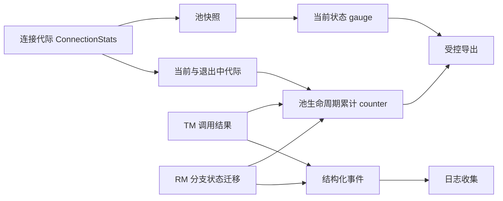

# WP07 可观测性实现契约（草案）

本文件细化 [V1 验收清单](../phase-0/v1-implementation-acceptance-checklist.md) 中的 WP07 指标与结构化日志要求，不变更其范围或完成状态。`PoolHandle::snapshot` 现提供当前槽位、连接代际及池生命周期累计计数；导出、跨进程持久计数、完整 TM/RM 状态与日志要求仍待实现和验证。

## 当前源码核对（2026-11-25）

初次对 `crates/seata_transport/src`、`crates/seata_tm/src`、`crates/seata_rm/src` 与 `crates/seata_db_mysql/src` 中的 `.rs` 文件执行 `rg -n '(tracing::|log::|println!|eprintln!)'` 时，未找到生产路径的关联事件日志调用；仅找到 MySQL 配置对 SQLx 语句和慢语句日志的关闭设置。这个历史源码扫描不能证明运行时没有外部日志，也不能证明其他 crate 的状态。此后 TM/RM RPC 出口与 RM 回调本地决策已新增结构化事件，见下文；传输、持久分支状态、MySQL 和生产日志收集仍待实现。

## 事件与采样边界

- `PoolSlotSnapshot::connection` 与槽位状态分别采样，不是同一瞬间的原子视图。消费者须以 `generation` 校验归属；字段为 `None` 表示当前无可采样连接，不能解释为历史计数归零。
- TM/RM 的 `connection_snapshot` 已对外暴露各自所拥有连接池的只读快照，使调用方无需取得业务通道或发送请求就能观测当前连接；快照不授予关闭、重连或事务恢复权限。该入口不替代累计导出和结构化事件。两项真实 TCP 定向测试先因方法缺失而编译失败，补充入口后通过；Rust 1.99/1.85 的 TM/RM 目标测试、全目标严格 Clippy 和格式检查通过。
- `ConnectionStats` 中除 `pending` 和 `closed` 外的数字是**单连接代际内**的计数。`PoolSnapshot::cumulative` 现在把已归档、退出中和当前代际的有界计数相加；短连接即使在可选表发布前退出，也由监督器带入退出中集合，任务关闭后恰好归档一次。对外导出仍须处理进程重启和采样瞬间的竞态，不能把这些计数当作业务完成结果。
- 每个代际的 delta 基线只可与相同 `generation` 比较；使用池累计时不再自行叠加当前槽位的 `ConnectionStats`。新代际首次采样从零基线计算，不能对重连前的读数做减法；计数器回绕或进程重启须作为新的基线处理。断线重连、未发布短连接、重复撤回和关闭测试验证累计只计一次；Rust 1.99/1.85 的传输目标测试、严格 Clippy、格式检查及离线全工作区回归通过。
- `timed_out_after_send`、`cancelled_after_send` 是传输层不确定性事件。它们不等于 TC 已提交、已回滚或已拒绝。TM `UnknownOutcome`、RM 未决分支及 MySQL 本地 COMMIT 未决应分别统计，避免把不同语义合并为一个“失败”。

### 首期本机指标导出

- TM/RM 所有者应能签发仅允许采样的句柄。它可随服务持有，不授予获取连接、发送请求、关闭池或事务恢复的能力；所有者关闭后仍可读取最终累计值。
- 首期拉取服务只绑定回环地址，配置中要求 32–128 字节的可见 ASCII 访问令牌及至少一个 TM/RM 采样源；空源在绑定前拒绝，避免空的 200 响应。`GET /metrics` 必须携带唯一且匹配的 Bearer 凭据。拒绝非回环监听、重复/错误凭据、过长或超时的请求头；响应不回显令牌。远程采集须由部署侧经过认证和 TLS 的代理承担，本组件不能宣称已完成该部署门禁。
- 文本导出只允许固定指标名，以及 `role=tm|rm`、配置有界的数字 `slot`、固定槽位状态标签。池关闭、当前在途、槽位状态为 gauge；`PoolCounters` 字段为进程生命周期 counter。不得输出 XID、BranchId、请求 ID、资源 URL、凭据、SQL、锁键或原始帧，也不得把这些值用作指标标签。
- 真实 TCP 测试需覆盖授权成功、未授权/错误令牌、超长请求头、断线重连后的累计和关闭后的最终样本；格式和字段断言须检查敏感哨兵不出现。该服务通过后仍需生产代理、采集端、权限、告警和故障演练验收。

## 最低观测面

| 面 | 来源 | 语义和验收观察 |
| --- | --- | --- |
| 连接状态 | `PoolSnapshot` 的槽位状态、关闭位、代际 | 每个固定槽位仅有一个当前状态；连接撤回、退避、注册、Ready 和停机可区分。 |
| 在途请求 | 当前代际 `ConnectionStats::pending` | 注册及请求完成、超时、取消、断线后能够回到零；不得累计为 counter。 |
| 晚到响应 | `unmatched_responses` | 迟到、重复及未知 ID 共用该现有计数；若要细分，先增加源事件证据和测试。 |
| 传输不确定性 | `timed_out_after_send`、`cancelled_after_send`、写入结果 | 写后超时/取消与写前失败分开；测试在响应丢失和重连下验证最终累计数。 |
| 重试 | TC 回调和本地恢复的明确重试事件 | 只计算实际执行的尝试；调用方查询状态不算事务重发，TC 负责的事务重试不得归为 Rust 客户端重试。 |
| TM 结果 | `TmError::UnknownOutcome` 与可证明的权威响应 | 未知结果和明确拒绝分开；`recover_unknown` 仅建立受控恢复对象，不能改写原调用结果。 |
| RM 分支 | durable journal 的分支状态与 callback 结果 | 同一分支重复指令不重复计业务效果；监控应能区分 Pending、已完成、未决及重试。 |
| MySQL 本地结果 | COMMIT/Undo 恢复状态 | `Applied`、`NotAppliedFenced`、未决分别记录；只有数据库证据才能把未决收敛为确定结果。 |

## 标签与日志边界

- 指标标签只能使用固定枚举或有限配置维度，例如组件、操作类别、结果类别和槽位编号。XID、BranchId、请求 ID、资源 URL、用户名、密码、SQL、锁键和原始报文不得成为指标标签；槽位编号的基数受配置池大小约束。
- 结构化日志需要可关联的 XID、BranchId、资源标识和请求 ID 时，使用字段而非拼接消息；只在该事件确有对应标识时输出。资源标识必须经脱敏或稳定摘要化，不能把 JDBC URL 凭据和查询参数原样写入日志。
- TM 的一次 RPC 完成事件应区分收到响应、明确未发送和写后未知；记录操作、已有 XID 和实际请求 ID。收到响应只表示有权威报文，不能在解析 `ResultCode` 前记为业务成功。事件不得记录事务名称、完整请求/响应、凭据或 `TmError` 的原始调试表示。
- 当前 TM `tm_rpc_outcome` 事件使用 `tracing` 的 `seata_tm::rpc` target，字段为 `operation`、可选 `xid`、可选 `request_id` 和 `outcome`。`outcome=response` 仅表示收到了报文；`unknown` 表示可能已发送而无权威结果；`not_sent` 表示未发送。四项真实 TCP/不可达端点测试检验正常响应、明确拒绝仍归类为 response、丢失响应归类为 unknown、未连接且未分配编号归类为 not_sent，并断言只包含上述关联字段和静态消息。首次测试在无事件时失败，补充代码后通过；Rust 1.99/1.85 的 TM 目标测试、全目标严格 Clippy 和格式检查通过。应用仍需配置 tracing subscriber/收集端；该增量不证明日志落盘、脱敏配置或全链路追踪已交付。
- RM 出站 `rm_rpc_outcome` 事件现保留操作、可选 XID、请求中的正 BranchId 和实际请求 ID；资源标识只输出完整 SHA-256 摘要，不输出原值、`application_data`、锁键、请求/响应 Debug 或其他凭据。`response` 只表示收到报文，不能在检查 `ResultCode` 前表示分支成功；`unknown` 与 `not_sent` 保留写入边界。摘要只用于关联，不作为授权或碰撞安全的业务身份。四项真实 TCP/不可达端点测试验证正常响应、TC 明确拒绝、丢失响应与未分配请求编号，包含 `application_data` 敏感哨兵；首项测试在无事件时失败，补充实现后通过。第五项用带用户名、密码和查询令牌的虚构 MySQL URL 登记真实 RM 会话，验证事件只含固定摘要，不含这些明文。Rust 1.99/1.85 的 RM 目标测试、严格 Clippy 和格式检查通过。生产 subscriber、日志收集端、权限及摘要字典风险策略仍需另验。
- RM 的入站分支回调现于每个子请求完成本地分派决策后输出 `seata_rm::callback` 的 `rm_callback_decision` 事件：原始外层请求 ID、XID、BranchId、资源 SHA-256 摘要、Commit/Rollback 方向、映射后的 BranchStatus 和 ResultCode。该事件只说明本地决策，不能表示回包已送达 TC；相同分支的重复指令可有多次事件，但业务效果仍须仅执行一次。无效批次在任何资源效果前拒绝，不产生伪造的分支决策事件。真实 TCP 测试覆盖提交、重复提交、反向回滚及混合无效批次，分别验证三次决策事件与一次资源效果、无效批次零效果和零事件，并检查资源原文及凭据哨兵未进入字段。Rust 1.99/1.85 的 RM 目标测试、全工作区离线测试、严格 Clippy 和格式检查通过；生产 subscriber、回包送达观测、MySQL 分支状态事件及真实 Java TC 联试仍待验证。
- 未知结果事件应写明阶段、是否已尝试网络写入、连接代际、可用的恢复标识及下一步只读核对方式。日志和指标不得暗示超时意味着 TC 拒绝，也不得自动重放 Begin、分支注册或业务 SQL。
- 本机导出端口和 Bearer 校验已有组件测试；远程代理的认证/TLS、采样频率、保留期和监控告警阈值属于部署验收，不能从本机端点推断已具备。

## 完成前的最小验证

1. 定向单元测试先证明连接切换时旧代际最终增量只累计一次，新代际计数从自身零基线开始；连接快速建立并退出时不得因只轮询池快照而漏记。
2. 用原有请求生命周期构造写前超时、写后超时、响应丢失、迟到响应、取消、断线与停机，逐一检查 gauge/counter 和结构化日志，不只检查 HTTP 或导出端点返回成功。
3. 用 TM 明确拒绝/未知结果、RM 重复及未决回调、MySQL COMMIT 未决与恢复场景核对事件语义；验证没有隐含事务重试或重复业务效果。
4. 检查日志和导出的标签值不含密码、JDBC 凭据、SQL、原始报文及高基数字段。对照真实 Java TC 故障路径验收，保留外部 TC 指标缺陷的独立状态。

完成以上实现、跨组件测试、部署导出验证和故障演练后，才可评估清单中的 WP07 指标及日志勾选项。本文件自身不是完成证据。
