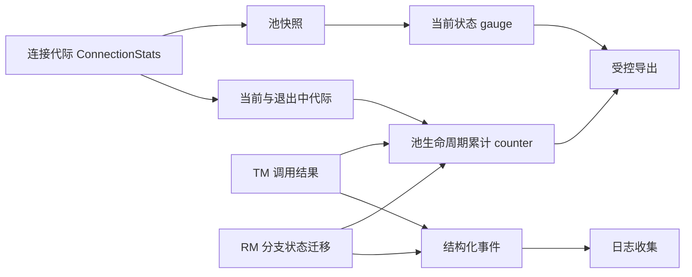

# WP07 可观测性实现契约（草案）

本文件细化 [V1 验收清单](../phase-0/v1-implementation-acceptance-checklist.md) 中的 WP07 指标与结构化日志要求，不变更其范围或完成状态。`PoolHandle::snapshot` 现提供当前槽位、连接代际及池生命周期累计计数；导出、跨进程持久计数、完整 TM/RM 状态与日志要求仍待实现和验证。

## 当前源码核对（2026-11-25）

初次对 `crates/seata_transport/src`、`crates/seata_tm/src`、`crates/seata_rm/src` 与 `crates/seata_db_mysql/src` 中的 `.rs` 文件执行 `rg -n '(tracing::|log::|println!|eprintln!)'` 时，未找到生产路径的关联事件日志调用；仅找到 MySQL 配置对 SQLx 语句和慢语句日志的关闭设置。这个历史源码扫描不能证明运行时没有外部日志，也不能证明其他 crate 的状态。此后 TM/RM RPC 出口与 RM 回调本地决策已新增结构化事件，见下文；传输、持久分支状态、MySQL 和生产日志收集仍待实现。

## 事件与采样边界

- `PoolSlotSnapshot::connection` 与槽位状态分别采样，不是同一瞬间的原子视图。消费者须以 `generation` 校验归属；字段为 `None` 表示当前无可采样连接，不能解释为历史计数归零。
- TM/RM 的 `connection_snapshot` 已对外暴露各自所拥有连接池的只读快照，使调用方无需取得业务通道或发送请求就能观测当前连接；快照不授予关闭、重连或事务恢复权限。该入口不替代累计导出和结构化事件。两项真实 TCP 定向测试先因方法缺失而编译失败，补充入口后通过；Rust 1.99/1.85 的 TM/RM 目标测试、全目标严格 Clippy 和格式检查通过。
- `ConnectionStats` 中除 `pending` 和 `closed` 外的数字是**单连接代际内**的计数。`PoolSnapshot::cumulative` 现在把已归档、退出中和当前代际的有界计数相加；短连接即使在可选表发布前退出，也由监督器带入退出中集合，任务关闭后恰好归档一次。对外导出仍须处理进程重启和采样瞬间的竞态，不能把这些计数当作业务完成结果。
- 每个代际的 delta 基线只可与相同 `generation` 比较；使用池累计时不再自行叠加当前槽位的 `ConnectionStats`。新代际首次采样从零基线计算，不能对重连前的读数做减法；计数器回绕或进程重启须作为新的基线处理。断线重连、未发布短连接、重复撤回和关闭测试验证累计只计一次；Rust 1.99/1.85 的传输目标测试、严格 Clippy、格式检查及离线全工作区回归通过。
- `timed_out_after_send`、`cancelled_after_send` 是传输层不确定性事件。它们不等于 TC 已提交、已回滚或已拒绝。TM `UnknownOutcome`、RM 未决分支及 MySQL 本地 COMMIT 未决应分别统计，避免把不同语义合并为一个“失败”。

### 首期本机指标导出

- TM/RM 所有者应能签发仅允许采样的句柄。它可随服务持有，不授予获取连接、发送请求、关闭池或事务恢复的能力；所有者关闭后仍可读取最终累计值。
- 首期拉取服务只绑定回环地址，配置中要求 32–128 字节的可见 ASCII 访问令牌及至少一个 TM/RM 采样源；空源在绑定前拒绝，避免空的 200 响应。`GET /metrics` 必须携带唯一且匹配的 Bearer 凭据。拒绝非回环监听、重复/错误凭据、过长或超时的请求头；响应不回显令牌。远程采集须由部署侧经过认证和 TLS 的代理承担，本组件不能宣称已完成该部署门禁。
- 连接文本导出只允许固定指标名，以及 `role=tm|rm`、配置有界的数字 `slot`、固定槽位状态标签；TM 调用扩展另允许下文固定四种 operation 与六种 outcome；RM 分支扩展另允许下文固定的 phase/state/outcome/operation。池关闭、当前在途、槽位状态为 gauge；`PoolCounters` 字段为进程生命周期 counter。不得输出 XID、BranchId、请求 ID、资源 URL、凭据、SQL、锁键或原始帧，也不得把这些值用作指标标签。
- 真实 TCP 测试需覆盖授权成功、未授权/错误令牌、超长请求头、断线重连后的累计和关闭后的最终样本；格式和字段断言须检查敏感哨兵不出现。该服务通过后仍需生产代理、采集端、权限、告警和故障演练验收。

## 最低观测面

| 面 | 来源 | 语义和验收观察 |
| --- | --- | --- |
| 连接状态 | `PoolSnapshot` 的槽位状态、关闭位、代际 | 每个固定槽位仅有一个当前状态；连接撤回、退避、注册、Ready 和停机可区分。 |
| 在途请求 | 当前代际 `ConnectionStats::pending` | 注册及请求完成、超时、取消、断线后能够回到零；不得累计为 counter。 |
| 晚到响应 | `unmatched_responses` | 迟到、重复及未知 ID 共用该现有计数；若要细分，先增加源事件证据和测试。 |
| 传输不确定性 | `timed_out_after_send`、`cancelled_after_send`、写入结果 | 写后超时/取消与写前失败分开；测试在响应丢失和重连下验证最终累计数。 |
| 重试 | TC 回调和本地恢复的明确重试事件 | 只计算实际执行的尝试；调用方查询状态不算事务重发，TC 负责的事务重试不得归为 Rust 客户端重试。 |
| TM 结果 | `TmError::UnknownOutcome` 与可证明的权威响应 | 未知结果和明确拒绝分开；`recover_unknown` 仅建立受控恢复对象，不能改写原调用结果。 |
| RM 分支 | durable journal 的分支状态与 callback 结果 | 同一分支重复指令不重复计业务效果；监控应能区分 Pending、已完成、未决及重试。 |
| MySQL 本地结果 | COMMIT/Undo 恢复状态 | `Applied`、`NotAppliedFenced`、未决分别记录；只有数据库证据才能把未决收敛为确定结果。 |

## 标签与日志边界

- 指标标签只能使用固定枚举或有限配置维度，例如组件、操作类别、结果类别和槽位编号。XID、BranchId、请求 ID、资源 URL、用户名、密码、SQL、锁键和原始报文不得成为指标标签；槽位编号的基数受配置池大小约束。
- 结构化日志需要可关联的 XID、BranchId、资源标识和请求 ID 时，使用字段而非拼接消息；只在该事件确有对应标识时输出。资源标识必须经脱敏或稳定摘要化，不能把 JDBC URL 凭据和查询参数原样写入日志。
- TM 的一次 RPC 完成事件应区分收到响应、明确未发送和写后未知；记录操作、已有 XID 和实际请求 ID。收到响应只表示有权威报文，不能在解析 `ResultCode` 前记为业务成功。事件不得记录事务名称、完整请求/响应、凭据或 `TmError` 的原始调试表示。
- 当前 TM `tm_rpc_outcome` 事件使用 `tracing` 的 `seata_tm::rpc` target，字段为 `operation`、可选 `xid`、可选 `request_id` 和 `outcome`。`outcome=response` 仅表示收到了报文；`unknown` 表示可能已发送而无权威结果；`not_sent` 表示未发送。四项真实 TCP/不可达端点测试检验正常响应、明确拒绝仍归类为 response、丢失响应归类为 unknown、未连接且未分配编号归类为 not_sent，并断言只包含上述关联字段和静态消息。首次测试在无事件时失败，补充代码后通过；Rust 1.99/1.85 的 TM 目标测试、全目标严格 Clippy 和格式检查通过。应用仍需配置 tracing subscriber/收集端；该增量不证明日志落盘、脱敏配置或全链路追踪已交付。
- RM 出站 `rm_rpc_outcome` 事件现保留操作、可选 XID、请求中的正 BranchId 和实际请求 ID；资源标识只输出完整 SHA-256 摘要，不输出原值、`application_data`、锁键、请求/响应 Debug 或其他凭据。`response` 只表示收到报文，不能在检查 `ResultCode` 前表示分支成功；`unknown` 与 `not_sent` 保留写入边界。摘要只用于关联，不作为授权或碰撞安全的业务身份。四项真实 TCP/不可达端点测试验证正常响应、TC 明确拒绝、丢失响应与未分配请求编号，包含 `application_data` 敏感哨兵；首项测试在无事件时失败，补充实现后通过。第五项用带用户名、密码和查询令牌的虚构 MySQL URL 登记真实 RM 会话，验证事件只含固定摘要，不含这些明文。Rust 1.99/1.85 的 RM 目标测试、严格 Clippy 和格式检查通过。生产 subscriber、日志收集端、权限及摘要字典风险策略仍需另验。
- RM 的入站分支回调现于每个子请求完成本地分派决策后输出 `seata_rm::callback` 的 `rm_callback_decision` 事件：原始外层请求 ID、XID、BranchId、资源 SHA-256 摘要、Commit/Rollback 方向、映射后的 BranchStatus 和 ResultCode。该事件只说明本地决策，不能表示回包已送达 TC；相同分支的重复指令可有多次事件，但业务效果仍须仅执行一次。无效批次在任何资源效果前拒绝，不产生伪造的分支决策事件。真实 TCP 测试覆盖提交、重复提交、反向回滚及混合无效批次，分别验证三次决策事件与一次资源效果、无效批次零效果和零事件，并检查资源原文及凭据哨兵未进入字段。Rust 1.99/1.85 的 RM 目标测试、全工作区离线测试、严格 Clippy 和格式检查通过；生产 subscriber、回包送达观测、MySQL 分支状态事件及真实 Java TC 联试仍待验证。
- 未知结果事件应写明阶段、是否已尝试网络写入、连接代际、可用的恢复标识及下一步只读核对方式。日志和指标不得暗示超时意味着 TC 拒绝，也不得自动重放 Begin、分支注册或业务 SQL。
- 本机导出端口和 Bearer 校验已有组件测试；远程代理的认证/TLS、采样频率、保留期和监控告警阈值属于部署验收，不能从本机端点推断已具备。

## 完成前的最小验证

1. 定向单元测试先证明连接切换时旧代际最终增量只累计一次，新代际计数从自身零基线开始；连接快速建立并退出时不得因只轮询池快照而漏记。
2. 用原有请求生命周期构造写前超时、写后超时、响应丢失、迟到响应、取消、断线与停机，逐一检查 gauge/counter 和结构化日志，不只检查 HTTP 或导出端点返回成功。
3. 用 TM 明确拒绝/未知结果、RM 重复及未决回调、MySQL COMMIT 未决与恢复场景核对事件语义；验证没有隐含事务重试或重复业务效果。
4. 检查日志和导出的标签值不含密码、JDBC 凭据、SQL、原始报文及高基数字段。对照真实 Java TC 故障路径验收，保留外部 TC 指标缺陷的独立状态。

完成以上实现、跨组件测试、部署导出验证和故障演练后，才可评估清单中的 WP07 指标及日志勾选项。本文件自身不是完成证据。

## MySQL Undo 摘要拒绝事件

生产校验入口在新记录的摘要缺失或不匹配时发出 WARN 事件，目标为 seata_db_mysql::undo，消息为 mysql_undo_checksum_rejected。关联字段只有 xid、branch_id、resource_digest 与 outcome=unknown。资源标识使用 SHA-256，正文、原 SQL、应用数据、账号凭据及两侧 Undo 摘要均不进入该事件。这个事件表示本次校验拒绝，原 TC 的后续重试仍可产生独立事件。

固定 MySQL 和原 Java TC 的现场用例捕获三次拒绝，分别来自摘要缺失的恢复报告、改写 Undo 的独立恢复及其恢复报告。用例要求恰好三个事件和固定字段集合，检查资源 URL、业务值与夹具密码未出现在事件中。恢复原字节后，原分支仍完成一次报告与原 TC 提交。没有事件的旧实现先在目标断言失败。

[失败对照](evidence/java-tc-changed-commit-report/run-undo_checksum-1.99-8a810468/client-stdout.log) · [Rust 1.99 事件](evidence/java-tc-changed-commit-report/run-undo_checksum-1.99-77ffe2fc/checksum-events.json) · [Rust 1.85 事件](evidence/java-tc-changed-commit-report/run-undo_checksum-1.85-d7c2f40c/checksum-events.json)

应用仍需配置 tracing subscriber 和生产日志收集端。此增量覆盖摘要拒绝，完整 MySQL 提交状态事件、回调送达、指标与部署验收继续。

## TM 调用结果计数契约

TransactionManager 签发 TmMetricsSampler，只能按固定 TmOperation 读取 TmOperationMetrics；没有发送、关闭、恢复或修改计数的公开能力。每个管理器一份进程内累计，采样器在管理器关闭后仍可读取，不跨重启持久化。固定四种操作不以 XID、BranchId、请求编号、资源或用户内容作标签。

统计进入正式 Begin 和 End/Status 调用路径的尝试；参与方不发送的结束、持久来源存储阶段和业务自身结果不计作原生 RPC 结果。每次已轮询尝试增加 active，返回或取消时归还。正常返回互斥分类：observed（有效权威响应，包括 AsyncCommitting、Rollbacking 等非最终状态）、tc_rejected、unknown（包括 may_have_effect 的协议错误）、not_sent（有明确写前证据）、local_rejected（本地前提拒绝）。没有返回结果的 Future 取消或 panic 只记 cancelled；写前/写后取消需另看传输层，不把取消伪造成明确拒绝。protocol_errors 为可与上述分类重叠的附加计数。

快照是并发原子字段逐项读取，不保证所有字段属于同一瞬间；累计计数饱和不回绕，active 是当前调用数。导出使用固定 operation=begin|commit|rollback|status 和六种固定 outcome，最多 32 条 TM 调用序列。可以单独提供 TM 调用采样器，原仅连接来源构造方式保持兼容。

验收：真实 TCP 的有效非最终响应、TC Failed、响应丢失、无效响应、未发送和取消；Commit/Rollback 保留原结果且不重放；管理器关闭后最终快照；通过真实 Bearer HTTP 端点核对准确计数、固定序列上限、拒绝凭据和身份哨兵泄漏。原 Java TC 故障路径、RM 分支状态、生产采集和告警继续独立验收。

## RM 日志状态与分派计数契约

RmMetricsSampler 由 FileBranchStore 或 ResourceManager 签发，只持有有界原子计数，不持有日志文件、租约、目录或分派能力。统计作用域为一次日志打开：多个管理器/手工分派器共享同一日志时共享计数，重开后分派累计归零；状态 gauge 从校验通过的全部日志重放记录重建。关闭后旧采样器保留最终快照，不能阻止同一路径重新打开。

固定 Commit/Rollback 各记录保留索引中的 Pending/Completed/RetrySafe/Rejected 数量。这是 RM 日志保留条目，不是原 TC 活跃分支数量。只有实际写入并同步后才能更改 gauge；写入故障保留最后确认值并标记 journal_faulted，不能把未确认的完成算入成功。journal_closed 表示日志所有者进入销毁；不是文件锁释放或数据库停机证明。

分派事件区分 Applied、Rejected、NotApplied/RetrySafe、Unknown、ManualIntervention、复用 Completed、复用 Rejected、错误和取消；active 跟踪已轮询分派作用域。Apply/Recover 入口各记录尝试数，不把 recover 确认 Applied 误称为重新执行资源。错误和取消不推断没有资源效果，Pending 继续保留。统计覆盖同日志的正式回调及显式手工分派，不授予回调来源权限，也不能表示回包已经送达 TC。

认证 HTTP 通过 with_rm_branches 增加固定 phase、state、outcome、operation 枚举维度，共 34 条序列，不用 XID、BranchId、资源、文件路径或凭据作标签。快照逐字段采样，累计饱和不回绕。验收覆盖实际日志重开与文件锁、同步失败、资源未决/恢复/重复/冲突/取消、原连接回调、HTTP 认证与字段边界，以及固定原 Java TC/MySQL 联试；生产采集与告警继续独立验收。

RM gauge 只统计已确认索引；取消中的后台追加若随后同步完成，gauge 仍随索引更新，而原未返回分派只记 cancelled。Applied/Rejected/RetrySafe counter 仅统计已返回且确认相应日志同步的分派结果。重开验收先制造非零 duplicate_completed，再证明新采样器累计归零，旧采样器也未持有文件锁。

原 TC 允许旧会话上有多个同身份回调。现场计数必须按原始帧实际数量核对停机后的 cancelled，所有旧请求必须保持完整原身份、没有旧会话成功回包，replacement 只允许一次完成响应；资源 apply 仍严格一次。首次快照是并发观测，active 可处于 1 到旧会话最终请求数之间，不能将它伪装为原始帧总数。

所测回滚场景原 TM RPC 期限固定 10 秒。若原 TC 在期限后返回 Failed/RollbackRetrying，客户端原 Unknown 仍保留；线缆验收只在原请求关联、到达晚于期限、错误消息含原 XID/BranchId、状态为 RollbackRetrying，且后续只读状态为 Finished 时接受这一记录。提前 Failed、错误状态/身份及把已观察结果伪装成未知均拒绝。这是原 TCP 观测的校验规则，不变更客户端期限和重试策略。

## RM 出站调用计数契约

ResourceManager 和 ResourceClient::call_metrics_sampler 签发 RmCallMetricsSampler，按三种固定 RmOperation 读取 RmOperationMetrics。每个管理器与其全部客户端克隆共享一份；重建管理器归零，不与日志作用域的分派累计混用。采样器只持有固定原子计数，不持有池、目录、资源、文件或发送能力。管理器关闭后，保留的客户端仍可产生本地拒绝/未发送计数；全部客户端退出后累计保持最终值。

每次已轮询的 BranchRegister、BranchReport、LockQuery 路径维护 active。注册回执接口包括其语义校验，嵌套低层调用不得重复计数。有效权威成功响应为 observed，正分支号才可计注册成功；成功 LockQuery 的 lockable=false 仍为 observed。其余结果互斥区分 tc_rejected、unknown、not_sent、local_rejected、cancelled。协议错误另外计数，写后协议错误同时属于 unknown。取消不推断传输边界，也不伪造 TC 结果；原请求、可选字段、错误分类和重试策略保持原有语义。

认证 HTTP 通过 with_rm_calls 增加固定三种 operation 与六种 outcome，加 active 和 protocol_errors，共 24 条序列。不得记录 XID、BranchId、资源、请求编号、锁键、application_data 或凭据。采样逐字段读取，累计饱和不回绕。验收包括共享克隆、单次回执、明确 Failed、无效分支号、丢响应、取消、未发送、原字段保留、关闭后调用、认证 HTTP 与固定原 Java TC 场景。

## MySQL 恢复控制事务计数契约

MySqlDataSource 及使用同一数据源克隆的 MySqlDataSourceManager 签发 MySqlRecoveryMetricsSampler，作用域为一次数据源创建及其全部克隆，不随管理器重建清零。六种固定控制动作是 enroll、observe、bind_commit、bind_rollback、commit、rollback；只计实际轮询进入内部 control 的调用，不把公开入口在 control 前的非法身份拒绝计为数据库操作。

每次 control 维护 active，返回时互斥记录 completed、unknown_commit、before_commit_error；取消或 panic 记 cancelled。completed 只表示本次独立控制事务在期限内返回 Ok，可能仅确认登记、方向或只读回滚，不能证明业务提交。成功结果另按原 BranchResolution 记录 applied 或 unresolved；Applied 可来自读取已有终态，不作为业务执行次数或 SQL 重放计数。unknown_commit 仅来自原 MySqlRecoveryError::CommitOutcomeUnknown，before_commit_error 不证明旧业务未执行。取消后 MySQL 仍可能迟到提交，指标不得改变原恢复行为。

采样器仅持固定原子计数，无池、资源、身份和恢复权限；逐字段采样，累计饱和不回绕，不查询数据库聚合。默认关闭的 observability mysql 特性可通过 with_mysql_recovery 导出六动作各 active、四结果以及 applied/unresolved，共 42 条固定序列；不含 XID、BranchId、URL、SQL、锁键或凭据。验收须包括实际 MySQL 持久化与重复读取、提交前错误、受阻取消、COMMIT 确认丢失及后续原分支恢复，不能以成功 HTTP 代替数据库事实。该增量不代表一阶段业务 COMMIT、独立 Undo API 或完整 MySQL 指标均已覆盖。

## 独立 MySQL Undo API 计量（实施基线，2026-11-27）

对数据源的 rollback_undo_log（含内部序列化器分派）与 fence_undo_log 实际已轮询调用各结算一次。固定 operation=rollback|fence，累计 completed、unknown_commit、before_commit_error、cancelled 分开；active 是在途 gauge。非法身份计本次 COMMIT 前错误；Future 未轮询不计，轮询后取消或 panic 由守卫记取消，不推断 COMMIT 阶段。

成功观察另区分 consumed、fenced_inserted、fenced_existing、undo_present；observed_restored_rows 仅累计明确 Ok(Consumed) 返回的行数，不能当作所有实际数据库效果总数。未知 COMMIT 可能已产生补偿，禁止把它计成功或把后续围栏观察当作原补偿行数。重复读取既有围栏只增加观察次数。全部累计饱和不回绕，快照逐字段采样，不保证跨字段原子。

同数据源克隆共享只读采样能力，新连接建立独立数据源归零，关闭后仍可读。可选 mysql 导出增加固定 20 条序列，无身份、URL、SQL 或凭据标签；默认导出器不增加 SQLx 运行依赖。既有恢复管理器 control 计数与独立 Undo API 调用口径分开，不相加宣称业务效果次数。

验收须包含真实 MySQL 的成功/既有围栏/Normal 存在/输入错误/锁等待取消或期限、原 COMMIT OK 丢失的未知分类及同身份后续观察；通过受认证 HTTP 核对固定序列和敏感哨兵缺席，完成源代码反例、双 Rust 回归与严格 Clippy。该增量不关闭 WP05–07 或生产采集/告警部署门禁。

本节选定范围现已通过双 Rust 的真实 API、锁等待取消/期限、两个 API 的原 COMMIT OK 丢失及授权 HTTP 验证；各 12 项原证据削弱拒绝，正式结算变异目标失败且恢复后通过。固定 20 条序列、默认运行依赖及双版本 726 passed / 320 ignored 与受影响两组件严格 Clippy 见 [独立 Undo 指标证据](evidence/mysql-undo-metrics/README.md)。该结果不替代一阶段业务指标、生产日志/采集/告警及独立审查。

## 一阶段编排调用计量（实施基线，2026-11-27）

本增量按数据源克隆共享采样能力，分别观测 prepare、check_commit、commit_no_change、commit_changed、commit_and_report 五个实际阶段入口。Future 未轮询不计；进入后取消或 panic 解栈计 cancelled，不推断 SQL 或 COMMIT 发送边界。已准备、持有见证与本地提交确认分别命名；成功报告不证明全局提交。

准备结果保留有无真实回执及登记未知；提交前检查保留有无暂存见证。无变化提交区分不适用、COMMIT 未知和确认。有变化提交分别统计不适用、业务 COMMIT/见证确认、业务提交整体未确认、尝试记录失败且回滚已确认，以及尝试记录或回滚不确定；后两类均不声称已发送业务 COMMIT。成功报告入口区分本地失败/不确定、报告门闩失败、报告未知/明确失败和已观察响应。嵌套入口会分别计各阶段，不得相加当作事务或业务效果次数。

固定五种 operation、22 种类型化 outcome，其中仅导出各阶段适用结果及 active，共 31 条固定序列。默认构建的实验阶段为零不代表已启用能力；实验有变化提交仍默认关闭。快照逐字段读取，累计饱和不回绕，无身份、SQL、资源 URL 或凭据标签，不授予连接、关闭、报告或恢复权限。此增量不计业务 DML、显式回滚及失败报告的全部层级，亦不关闭生产采集、日志、告警或 WP05–07。验收要求真实 MySQL/原 TC 成功与未知/失败分层、取消、授权 HTTP、有效源代码反例、双版本回归和默认依赖检查。

所选范围双工具链现场、原 Java TC 六场景、结算变异和八项负控已验证；全工作区各 729 passed / 323 ignored 及严格检查见 [一阶段指标证据](evidence/mysql-phase-one-metrics/README.md)。本轮不关闭上述剩余范围。

## RM 原连接回调响应写入事件（实施基线，2026-11-27）

对已完成整批校验并形成响应的回调信封，进入原 PoolInbound::respond 时建立唯一事件作用域。使用独立 seata_rm::callback_write target，字段为原 signed request_id、connection_generation、response_count 及 outcome；固定 outcome 为 local_written、not_sent、unknown、cancelled。local_written 仅表示传输层确认本地完整写入，绝不表示 TC 接收、确认或全局完成。unknown 来自原 CallError::UnknownOutcome；not_sent 来自明确写前失败；作用域取消/解栈只记 cancelled，不推断写入阶段。无效整批不产生写入事件。

每个外层信封结算一次，平面批次不按分支重复记录写入。原 rm_callback_decision 同时携带 connection_generation，以原请求 ID 和代际关联本地分支决策与信封写入。事件不记录响应、原始错误、头、资源、应用数据、SQL 或凭据，不改变原回包、超时、重试、业务效果及停机行为。验收覆盖真实 TCP 单次/重复/反向/批次、原代际关闭、取消/写后未知分类、双工具链回归及固定 Java TC 原帧对照；完整生产采集管线仍另行验收。

该选定范围现已通过双工具链真实 TCP、原 Java TC 普通提交及两方向实际回包丢失重试验证；九项证据削弱及实际结算源代码变异均拒绝。写后未知的新增测试属于原错误类型分类，不等于真实 socket 写超时注入。全工作区各 732 passed / 323 ignored，详情见 [回调本地写入事件证据](evidence/rm-callback-write-events/README.md)。生产 subscriber/收集与剩余事件边界继续。

## 业务 DML 与显式本地回滚计量（实施基线，2026-11-27）

沿用数据源克隆共享的一阶段只读采样器，新增 execute、rollback 两个固定 operation。execute 仅在正式 MySqlLocalTransaction::execute 实际轮询后计量，返回 Ok 记 execution_completed（含零行），任何原错误记 execution_failed；二者都不证明本地或全局提交，也不把失败解释为业务 SQL 未执行。rollback 只计显式 rollback API，Prepared/Checked 的转发只在底层结算一次；返回 Ok 记 rollback_confirmed，原错误记 rollback_unconfirmed，不推断全局结果。自动 Drop 回滚不计显式 API，未轮询 Future 不计，进入后取消/panic 记 cancelled，active 在退出时归还。

原五阶段的 31 条导出序列保留原义，新增两阶段各 active/三个结果，共 39 条固定序列。不统计 SQL、行数或身份标签，不授予连接/发送/恢复权限。验收包括真实 MySQL 的多种 DML、零行、本地输入/数据库错误、锁等待取消和期限、原事务回滚后独立连接可见状态、共享克隆与关闭后最终样本、授权 HTTP、源代码反例与双 Rust 回归。失败报告和其他生产门禁仍独立开放。

本节选定行为已通过双 Rust 的真实 MySQL 五组现场、认证 HTTP 与两种正式源结算反例；恢复原字节后目标通过，每版本 12 项证据削弱拒绝。最终全工作区各 743 passed / 335 ignored、两组件严格 Clippy 与原始证据见 [业务与回滚指标](evidence/business-metrics/README.md)。原五阶段历史 31 条现场仍按其固定摘要解释，当前导出为 39 条。

## 失败报告分层计量（实施基线，2026-11-27）

增加 rollback_and_report_failure、prepare_failure_report、prepare_and_report_failure 三阶段，沿用原数据源的一阶段只读采样器。前者只在 Prepared 底层计一次，Checked 转发不重复；组合准备入口与其嵌套的 prepare/rollback/report 分别计阶段，不相加当作事务效果。观察到失败报告成功响应不是业务/全局成功；跳过无分支报告、本地回滚未确认、报告未知、其他报告错误分别计量。显式准备错误报告还区分不适用与已尝试门闩拒绝；后者不能合并成新网络未知尝试。组合入口成功返回准备对象、准备失败且未报告、实际报告结果分别计量。

原真实 Enrollment/Undo 错误的私有报告门闩携带数据源的计数能力，仅持原子计数，不持池/身份/恢复权限。它使错误离开管理器后仍归属原数据源；没有这份来源的本地/登记进度错误不能伪造数据源计数，组合入口仍能记录未报告。未轮询不计，取消或 panic 记 cancelled 并归还 active，不改变错误槽或一次性报告门闩。原七阶段 39 条序列保留，三阶段再加 24 条，共 63 条固定序列；默认关闭的实验报告入口保持关闭。新结果枚举追加在既有变体之后，保留现有数值位置。

验收涵盖真实 MySQL 与原请求/响应的回滚成功、驱动失联不报告、报告明确拒绝/丢失/取消、准备失败及旧错误再次调用门闩拒绝、无分支与非法输入、原回执/错误槽保留、关闭后采样、认证 HTTP、双工具链与源代码反例。固定原 Java TC 联试单独核对，不能把受控 TCP 同伴称为原 TC。生产收集、数据库事件及剩余计划保持开放。

本节所选真实 MySQL/TCP 与原 Java TC 场景已通过双工具链验证；每版本八个 native 目标、一个认证 HTTP 及八个原 Java TC 场景。三个正式源结算反例均由实际计数断言拒绝，恢复后通过；每 Java profile 的 12 项证据削弱拒绝。全工作区各 743 passed / 340 ignored、默认依赖与严格检查、一次端口绑定诊断及单行共享测试助手 lint 差异的精确输入核对见 [失败报告证据](evidence/failure-report-metrics/README.md)。当前固定导出为 63 条；该增量不关闭完整 WP07 或其他阶段。

## MySQL 恢复控制结果事件（实施基线，2026-11-27）

正式 MySqlDataSourceManager::control 的每次已轮询调用产生一个 INFO 结构化 mysql_control_outcome 事件，target 为 seata_db_mysql::control。字段固定为 operation、requested_phase、xid、branch_id、resource_sha256、outcome、resolution、commit_attempted，以及静态 message；资源仅输出完整 SHA-256。operation 使用原六种控制动作；原控制入口前的非法身份拒绝不产生日志，不新造身份或请求编号。

outcome 为 completed、unknown_commit、before_commit_error、cancelled；completed 只表示原控制 API 返回 Ok，可能为只读回滚或读取既有终态。resolution 只有原 Ok(Applied) 为 applied、Ok(Unknown) 为 unresolved，其余为 not_observed；不据此计算业务效果次数。commit_attempted 只在现有代码进入可能发送控制 COMMIT 的原位置设为 true，不能由 action 名称猜测：例如同一 Commit 动作读既有终态不发送 COMMIT。completed 且 commit_attempted=true 才表示该次控制 COMMIT 在原预算内确认，未知或取消即使服务器实际提交也不发布确认。

取消/panic 由调用作用域销毁结算，保留已经到达的 COMMIT 尝试标记，不推断未发送；正常返回与销毁不得重复输出。日志不记录 SQL、Undo、锁键、application_data、资源 URL、账号、密码、原始错误/帧或两侧摘要，不新增数据库查询、重试、回滚、权限或持久状态。应用仍需配置 subscriber、收集和追踪上下文；本项不交付完整生产采集管线。

验收须以真实 MySQL 控制写入/只读重复观察、提交前错误、实际锁等待取消及原 COMMIT OK 丢失/取消验证结果与尝试位，原字节恢复后同分支继续恢复；核对敏感哨兵缺席、source 反例、双 Rust 与固定原 Java TC 场景。

requested_phase 为 none/commit/rollback，来自原请求动作；尤其 Observe 保留原回调方向。该字段不冒充数据库当前持久方向，冲突/未确认时仍只表示原请求意图。

本节选定控制结果事件已通过双 Rust 的真实写入/重复读取、锁等待取消、原 COMMIT OK 截留后的未知/取消与同分支恢复，以及各三个固定原 Java TC 回调场景。原帧、事件和停止后的控制计数对照、每 profile 的 12 项证据削弱、三类正式源反例及当前源码逐字节绑定见 [控制结果事件证据](evidence/mysql-control-events/README.md)。全工作区各 744 passed / 343 ignored，受影响两组件全功能及默认严格检查通过；本项不关闭完整 WP07、生产管线或其余阶段。

## 独立 Undo 结果事件（实施基线，2026-11-27）

rollback_undo_log 和 fence_undo_log 在有效原身份的已轮询调用上各输出一次 INFO mysql_undo_outcome，target=seata_db_mysql::undo。字段为 operation、xid、branch_id、resource_sha256、outcome、observation、commit_attempted；资源仅输出完整 SHA-256，无法取得规范资源标识时为空字符串。非法输入与未轮询 Future 不输出身份事件，既有指标仍按原契约结算。

outcome 固定为 completed、unknown_commit、before_commit_error、cancelled；observation 仅在原 Ok 返回时为 consumed、fenced_inserted、fenced_existing、undo_present，其他结果为 not_observed。COMMIT 标记只在原实际尝试点设置，读既有围栏/Normal 不设置；不把取消或服务器已持久化但原响应未确认误记成功。完成标记先于日志输出，解栈不重复输出。禁止记录 SQL、Undo、原错误、URL、凭据，不增加数据库调用、重试或恢复权限。

验收覆盖真实补偿及重复观察、原锁等待取消与关闭池错误、两个 API 的原 COMMIT OK 截留后未知/取消、同身份继续观察、敏感字段边界、有效源代码反例与双 Rust 回归。本项不替代完整 WP07、生产采集和独立审查。

本节选定范围已通过双 Rust 的真实补偿/只读观察、两个 API 的行锁等待取消及四次原 COMMIT OK 截留/版本，同身份继续观察通过。四类正式源反例每版本均由目标断言拒绝，恢复原字节后最终现场通过；每版本十一项证据削弱拒绝。最终全工作区各 746 passed / 346 ignored，受影响两组件全功能与默认严格检查通过。最终输入、一次共享测试模块重复加载的诊断及剩余边界见 [独立 Undo 事件证据](evidence/mysql-undo-events/README.md)。本轮未重跑原 Java TC，不改变 Java Undo 格式、迁移或兼容路径，不关闭完整 WP07。

## 有界结构化日志订阅适配器（实施基线，2026-11-27）

新增默认关闭的 structured_logs 特性。应用显式创建 StructuredLogSubscriber、唯一 StructuredLogReceiver 与只读 StructuredLogSampler，自行选择作用域或全局 Dispatch；组件不替换既有 subscriber、不创建线程或文件、不主动联网。只接受既有七种正式事件模板（TM/RM 出站、RM 决策/回包、MySQL 控制、Undo 结果/摘要拒绝）。按静态 target/字段集合先拒绝额外字段，再格式化；固定消息和枚举/数值/资源摘要校验失败时整条拒绝，不输出部分身份。任意应用 span 字段和未知事件不进入导出。

队列容量 1–4096，单条含换行的 JSON 上限 512–262144 字节，二者乘积不得超过 64 MiB。字段格式化和最终 JSON 编码均有字节预算。所有源字段保留 tracing 原文本语义，包括 Option 的 Debug 表示和 signed request_id；JSON 转义换行与引号，不从 Debug 文本伪造新身份。顶层补充 target、level、timestamp_unix_millis，fields 保存原字段。元数据模板来自可信库调用点；XID 是允许的关联身份，不承诺对用户主动塞入身份本身的任意秘密做语义识别。

事件路径只用 try_send，不等待消费者；满队列丢弃新事件，关闭消费者后丢弃后续事件。accepted/received/full/closed/oversize/invalid 六计数饱和累计、逐字段采样，不宣称落盘或远端接收。Receiver.close 停止接纳并允许取走已有有界队列，之后 recv 返回 None；仅保留 sampler 不延长队列寿命。组件不输出自己的错误日志以避免递归。应用负责消费写入、权限、落盘刷新、远程认证、保留与告警。

验收要求配置/溢出/JSON 转义/超预算/额外敏感字段在格式化前拒绝、并发满队列不阻塞、关闭后排空、所有现有模板、真实 TM/RM TCP 路径和 MySQL 事件接入、双 Rust 回归、有效源代码反例及默认依赖边界。该适配器不等于完整生产日志采集、span 链路追踪或 WP07 完成。

本节选定适配器已通过双 Rust 的十个目标测试与各一项真实 MySQL 接入，真实 TM/RM/回调/数据库 JSON 经过自有文件 sync_all 与回读。四类源码反例每版本目标失败、精确恢复后通过；每版本十五项证据削弱拒绝。最终全工作区各 757 passed / 347 ignored、观测组件全功能/默认/仅日志特性严格检查通过，默认及仅日志依赖均无 SQLx。最终输入、脚本标签和早期原型边界见 [有界日志适配器证据](evidence/structured-logs/README.md)。生产 sink/保留/认证采集告警、应用既有日志组合、丢弃计数的端点导出、跨进程追踪和完整 WP07 继续开放。

## 日志交付计数的认证指标导出（实施基线，2026-11-27）

structured_logs 特性下 MetricsSources::with_structured_logs 接收现有只读 StructuredLogSampler，可作为唯一来源或与原 TM/RM/MySQL 来源组合。固定六条序列：seata_structured_logs_accepted_total、seata_structured_logs_received_total，以及 seata_structured_logs_dropped_total 的 reason=full|closed|oversize|invalid。标签不含身份、资源、请求编号、输出路径或凭据。没有该来源时不输出这六条序列。

沿用现有回环 Bearer 端点，采集不读取/消费 JSON 队列，不安装 subscriber，不持有发送、关闭或输出器能力，也不创建递归日志。采样逐字段、进程内饱和累计，accepted/received 不表示持久化或 TC 接收；不能把六计数相加当作业务效果。订阅器/消费者销毁后仍可读取最终累计，采样器不会延长队列寿命。默认特性和仅日志特性仍不增加 SQLx 运行依赖。

验收包括真实授权 HTTP 的六个计数与敏感字段缺席、错误令牌拒绝、关闭排空后最终样本、只保留指标源不延长队列寿命、与真实 TM 请求及原 32 条 TM 指标组合、有效源码反例和双 Rust 回归。生产抓取/告警部署和完整 WP07 继续独立验收。

本节选定接入已通过双 Rust 各三个真实认证 HTTP/TM TCP 目标，三个正式源反例每版本失败、精确恢复后通过，每版本九项证据削弱拒绝。最终全工作区各 760 passed / 347 ignored，观测组件全功能、默认、仅日志与仅 MySQL 严格检查通过；默认/仅日志依赖均无 SQLx。独立 oversize/invalid 采样、语法诊断、原 HTTP 和最终输入见 [日志指标接入证据](evidence/structured-log-metrics/README.md)。生产抓取、告警和完整 WP07 仍开放。

## 与应用日志栈组合的可选 Layer（实施基线，2026-11-27）

新增默认关闭的 structured_log_layer 特性，包含 structured_logs 和精确固定的 tracing-subscriber 0.3.23（关闭默认特性，仅 registry）。StructuredLogSubscriber::into_layer<S> 消费现有订阅器并返回可与应用 Registry/LookupSpan 订阅栈组合的 Layer，不自动安装/替换全局 subscriber。原独立订阅器和仅 structured_logs 的依赖边界保留。

Seata 分支使用官方 per-layer filter，仅接纳已有正式事件命名空间，不把应用过滤的 span/无关事件送入应用输出，并以无 Seata 层的同条件基线核对 Registry 行为；不以自己的过滤器全局拒绝应用日志。应用 span 的身份、父子、record、follows_from、enter/exit、克隆和最终关闭由原 Registry/应用 Layer 保持；Seata JSON 不添加 span 字段，字段校验、预算、满队列丢弃和六计数沿用原实现。应用全局过滤仍可拒绝 Seata 事件，应用须在启动时明确配置各层策略。

两个分支的输出策略独立；Seata JSON 的脱敏/内存预算不覆盖应用自己的日志或 span 导出，应用分支仍可执行原 I/O。组合不自动传播跨线程/进程上下文；显式 instrument/Dispatch 传播另行验证，不伪造追踪身份。验收覆盖动态过滤与 span 生命周期、七模板、应用字段与 JSON 分离、实际 TM/MySQL 接入、有效源反例、双 Rust 回归及默认/仅日志依赖树。生产采集、跨进程追踪与完整 WP07 继续开放。

本节选定 Registry/LookupSpan 组合入口已通过双 Rust 各五个目标、各一个实际 MySQL Layer 场景、三类源码反例和每版本十三项证据削弱。最终全工作区各 766 passed / 347 ignored，观测组件全功能/默认/仅日志/仅 MySQL/仅 Layer 严格检查与依赖边界通过。原应用动态过滤、span 生命周期、全局过滤、真实 TM 和七模板，以及 Registry 基线/静态过滤夹具诊断与依赖归档见 [Layer 组合证据](evidence/structured-log-layer/README.md)。本轮不声明任意手写 subscriber、自动跨线程/进程传播、生产采集部署或完整 WP07 完成。
