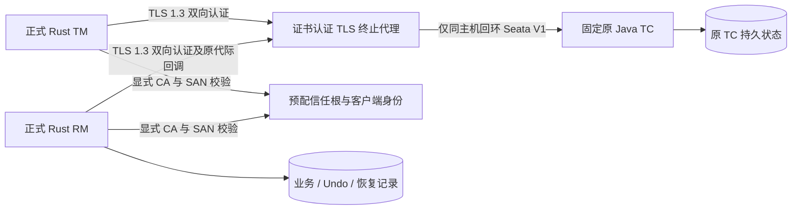

# WP07 Seata 传输 TLS 实施契约

本变更细化现有 V1 WP07 的 TLS/认证要求，不关闭 WP05–07 或修改实验提交门禁。规格事实源为本文件和既有 V1 验收清单；现有项目继续 Markdown 流程，不初始化其他 SDD 体系。

提供默认关闭的 tls Cargo 特性，以及显式选择 TLS 的 TcpConnection、ConnectionPool 和 TM/RM builder 入口。既有 ConnectionConfig/ConnectionPoolConfig 的 Copy 契约、明文入口、V1 字段、登记及业务重试边界保持兼容。

首个安全部署 profile 为 TLS 1.3 双向认证：客户端显式提供 DER CA 集、预期 DNS/IP SAN、客户端证书链与私钥。构造时拒绝空/格式错误/超预算输入；信任根与证书链各最多 32 项、每项最多 64 KiB、总输入最多 1 MiB，私钥最多 64 KiB。不提供跳过证书验证接口，不读取系统信任根，不输出证书、密钥或具体握手错误。Debug 仅显示固定安全 profile。

单次绝对 connect_timeout 同时覆盖 TCP 建连及 TLS 握手。只有客户端完成服务端证书/SAN 验证及自身握手后才启动 V1 帧任务和原 TM/RM 登记；TCP/服务端证书验证/握手返回的失败归为明确 V1 请求未发送，保持无请求 ID。TLS 1.3 客户端握手返回可能先于服务端验证客户端最后一轮；服务端随后拒绝客户端证书时，仍按原登记/帧写入标记区分未知与未发送，不能伪称所有客户端认证失败都在写前。TLS 握手失败不回退明文，重连始终复用相同安全配置；关闭必须打断握手，取消不得泄露长期 socket/任务。TLS 记录仍由 rustls 验证，原 V1 解码/有界队列/写入超时/回调原代际规则复用。

原 Java TC profile 允许独立 TLS 终止代理：Rust TM/RM 至代理采用 mTLS，代理至固定原 Java TC 只限同一受控主机回环地址。明确区分代理终止与 Java TC 原生 TLS；原 TC 的登记认证继续执行。代理必须验证客户端证书并且不接受明文前端。跨主机明文后端、证书签发/轮换/吊销、外部代理部署、完整权限与生产认证验收仍开放。

验收要求双 Rust 1.99/1.85 真实 TCP/TLS 通过与错误 CA、错误 SAN、无效客户端身份、明文对端、握手期限/取消；池的原登记、重连、回调原连接和关闭保持成立。固定原 Java TC 场景须同时核对 TLS 会话、解密后的原帧和 MySQL/Undo 事实，不能只靠 TLS HTTP/握手通过。默认特性依赖、严格 Clippy、全工作区回归、有效负控及证据摘要均需保留。


TLS 写入回执还必须等待加密记录 flush 完成；flush 与原 write_all 共用同一写期限，受阻或失败时保留原写后未知分类，不能在接受明文到内部缓冲后就发布 responses_written 或 local_written。确定性 BufWriter/容量 1 的双工流先暴露提前成功，再验证完整排空及 flush 受阻期限。此边界依据锁定 tokio-rustls 0.26.4 的 poll_write/poll_flush 源码核对。


## 已验证部署边界与接入



应用启用 seata-transport/tls、seata-tm/tls 和 seata-rm/tls；MySQL 联试额外通过 seata-db-mysql/transport_tls 转发三项特性，后者不是 MySQL 数据库连接 TLS 开关。SDK 不从环境变量自动读取或选择 TLS，应用显式加载安全材料并在创建管理器前传入：

```rust
use seata_transport::TlsClientConfig;

fn transport_security() -> Result<TlsClientConfig, Box<dyn std::error::Error>> {
    Ok(TlsClientConfig::new(
        "seata.gateway.example".into(),
        vec![std::fs::read("D:/deployment/tls/root.der")?],
        vec![std::fs::read("D:/deployment/tls/client.der")?],
        std::fs::read("D:/deployment/tls/client.key.der")?,
    )?)
}
```

将此配置传给 TransactionManagerBuilder::transport_tls 或 ResourceManagerBuilder::transport_tls 后再 build；raw 使用 TcpConnection::connect_tls 或 ConnectionPool::start_tls，带原角色登记使用 ConnectionPool::start_registered_tls。数值端点必须指向 TLS 代理监听地址，预期 SAN 独立指定；不得因证书失败改用原明文构建器。私钥读取权限、生产代理的客户端授权和后端回环隔离须在部署阶段落实，测试私钥不能用作生产身份。

无效服务端链/SAN 在 V1 任务启动前失败，调用者可通过池槽位 last_failure 观察静态 TlsHandshakeFailed。服务端拒绝客户端证书可能晚于客户端握手返回，登记/业务的结果仍服从原写入标记与 Ready 门槛。重连不重放事务、分支登记或业务 SQL，只执行原会话身份/缓存资源登记。恢复和停止仍使用原持久凭证及授权流程；TLS 会话本身不授予事务恢复或终结权限。

本轮固定源码已通过 [双版本原 TC、真实 TLS 和源代码负控](evidence/transport-tls/README.md)。证书轮换/吊销、生产网关授权部署、其他网络 profile、负载安全审查和独立外部审查继续，WP07 与完整 V1 未关闭。
