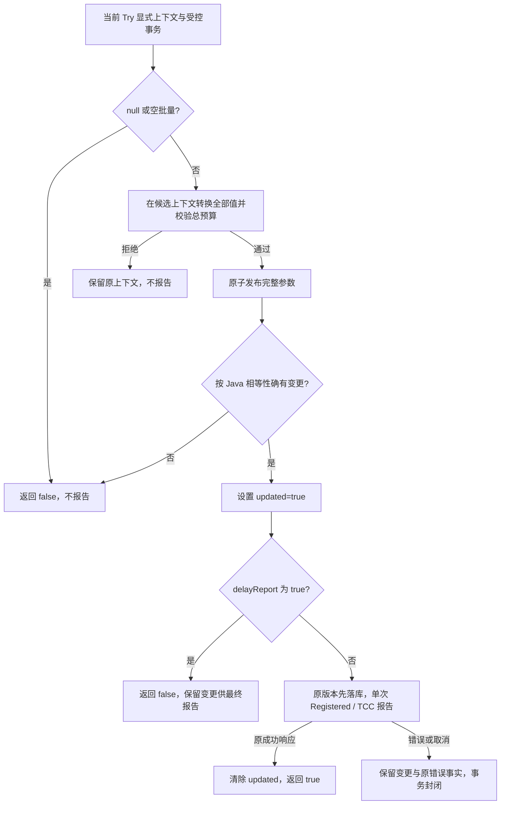

# TCC util 自动参数报告（2026-11-28）

延续 [正式 TCC 契约](../../../phase-2/tcc-contract.md)，在已有持久报告上接通 `BusinessActionContextUtil`，不创建第二套规格。原登记回执、019/020 结构和协议、报告版本与 SHA-256、未知响应及回调终态检查均沿用 [前一增量](DYNAMIC_CONTEXT_REPORTS.md)。本增量的最终源码权威批次由 [ledger](../../tcc-context-util.json) 指定。

utility 显式借用上下文和当前事务，替代 Java ThreadLocal 的隐式获取；异步任务迁移不会串用身份。没有后台线程、独立全局客户端或隐式重试。未变化入口不会顺便报告此前已有的 updated；显式 util `report_context` 只在 updated=true 时请求事务报告。资源管理器的最终原字节变化检查独立保留：Java Double 比较相等不能证明原 JSON 字节相同。

标量保留原 JSON 值。复合 JSON 对象/数组转成 JSON 字符串，供二阶段读取；字符串中保留输入 RawValue 的数值和空白，不添加 Java 集合类标记。本次 Java 对照使用不可变 Map/List（延续先前 `util_delay_object` 基线），不把 Java 任意可变对象、反射参数提取或自动类型反序列化宣称为已移植。预算失败在发布原上下文前完成，不能留下半批参数。

## 实际验证

固定原 Java util、ActionContextUtil、BusinessActionContext、DefaultResourceManager 源对象重新编译执行，19 项参数/标志/结果观察，含 7 次真实原 dispatcher 到受控 ResourceManager 出口的调用，5 次确认成功、2 次异常。源码逐字节核对固定 pin，依赖来自已固定服务器与模块产物。此出口探针仅用于 Java 方法语义对照，不计作网络或数据库成功。先前 46 项变更观察中保留的 util 对象用例现在也由 Rust 执行比较。

双版本各 5 项新组件测试通过：19 项 Java 观察、旧 util 对象用例、预算拒绝原子性与复合原字节精度、仅确认成功才清除标志、取消不重开事务与显式上下文隔离。全工作区每版 801 passed / 388 ignored，179 个成功 harness 摘要；RM/TCC/XA/MySQL 全目标严格 Clippy 通过。

真实 MySQL 和固定原 Java TC 的动态业务走新 util：批量合并 amount/precise/object/array；对象和数组在报告中为字符串，复合值内的小数原字节保持。延迟模式等待最终报告；立即模式由 util 自动发送首次报告，再将 final 字段延迟到最终报告。精度专用模式继续验证 Java dirty 标志不等同原字节。仍为双版本 32 个动态分支场景、12 个原 TC 动态完整事务；重复/断线静态事务和 54 项进程/数据库恢复作为回归独立计数。

源码反例新增七类：忽略延迟、同值也报告、批量 null 覆盖、回执前清除标志、复合值不转字符串、半批更新、未报告却清除标志。每个反例必须在独占 D 盘副本中编译成功后实际执行选定测试并行为失败；编译错误或未改变行为的改写不计入。合计核心 24 类 × 双版本 48 次，加已有动态协议/终态等 12 次，合计 60 次实际行为反例拒绝。

首次工作区执行暴露测试用 Value 比较 `1.00` 与 Java 重编码 `1.0` 的问题，现分别核对 Java 相等/不报告语义与 Rust 原字节保留；不能通过舍弃精度来让测试变绿。早期 Java 探针未设置 TCC 模式、首次未真正改变 null 行为的反例和早期特性组合失败均保留作诊断，不能作为最终验收。

## 剩余范围

原 Java TC 动态报告专用的故障/并发/拓扑、动态写入进程与数据库崩溃矩阵、权限/保留清理/负载/运维尚未完成；静态回归不替代这些动态门禁。Java 反射/注解参数、完整任意对象转换也未据此宣称完成。AT/XA 剩余门禁及 Phase 5–7 保持开放，完整计划尚未完成。

独立验证实际拒绝 1260 项证据削弱，其中新增 Java util 130、原 Java 变更 24、动态 206、静态 managed 154、进程 642、原 TC 故障 104。最终命令、验证器字节和原输出见 validation 批次。三次动态源码反例构建因 Windows LNK1104 中断，数据库已清理，这三批不作为验收；ledger 指向完整替代批次。
