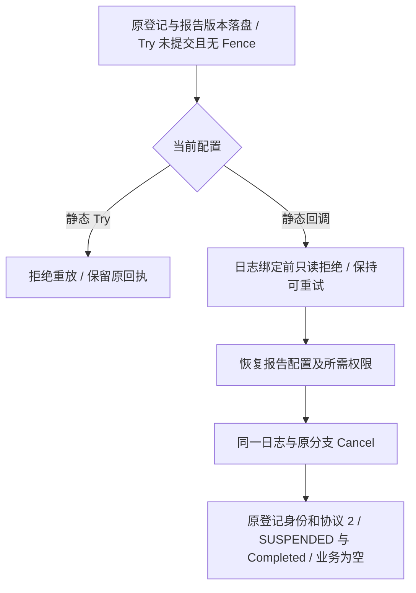

# TCC 配置切换：仅报告清单状态

报告 0/1 已持久化而 Try 回包丢失、业务事务已回滚时，没有 Fence 不能证明这是静态分支。修复前两项真实 RED 分别观察到静态 Try 重放业务，以及错误静态 Cancel 用最新参数写入 Completed/SUSPENDED。原始失败及独立 SQL 作为诊断保留，不计成功验收。

预检不等待 Fence 行锁；实际执行在 Pending 后以当前读重新检查来源。只接受 MySQL 1146 作为可选 020 缺表，真实 1142 保留错误并拒绝业务和日志写入。权限用例先授予 Fence/业务与元数据检查权限，再实际拒绝 020 访问；恢复时补齐 020 的 SELECT/INSERT/UPDATE/DELETE 权限并使用报告配置，不宣称仅 SELECT 是最小生产权限集。

双 Rust 共 8 项原生函数覆盖 12 个配置场景：无可选表、其他动态分支、静态原 Fence 加版本 0、单连接池、错误静态 Try/回调及权限恢复。独立 SQL 核验版本 SHA-256、原登记/Fence 字节、协议、终态、业务 DML 和 Undo 数量；68 项证据削弱被拒绝。隔离副本三类错误生产实现各在双版本发生目标断言失败，共 6 次，原副本基线先通过，不把编译/环境失败计作反例。

当前源码重跑静态 MySQL 16 项、动态 32 个分支场景、进程/同库恢复 54 项、原 Java TC 静态正常/故障 4/8 笔、动态正常/故障 12/36 笔；工作区每版 801 passed / 392 ignored，179 个成功摘要，严格 Clippy 通过。选择执行的 ignored 原生场景单独核验。原 Java TC 认证覆盖仅用于本地夹具，协调器未修改。原 TC 重叠回调中的明确可重试失败单独解析，必须有同身份、同会话的先行未结束回调、后续终态成功及原 TC 重试日志；不把失败当作完成。源码、命令、原帧、独立 SQL 与校验输出见 [验证目录](validation_configuration_20261128_final)，可信摘要见 [机器 ledger](../../tcc-configuration-transition.json)。历史源码反例/Java 观察仅在对应源码仍一致时复核，不合并冒充本轮新反例。

选定配置增量完成。完整 TCC、动态进程/数据库崩溃、更广配置竞争/跨实例拓扑、生产性能/运维，以及 AT/XA 和 Phase 5–7 仍未完成。Java Undo 格式、数据库迁移、公共 API 和严格日志身份规则未改动。所有构建/数据位于 D/E；此前缓存删除被自动审批拒绝，未执行，隔离构建改放 E 盘。
