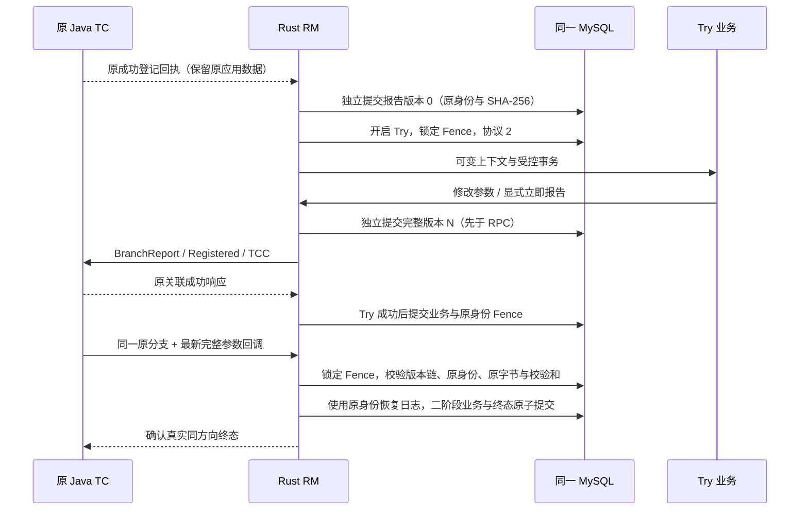

# TCC 持久动态上下文报告（2026-11-28）

本增量按 [既有 TCC 契约](../../../phase-2/tcc-contract.md) 接通可选 MySQL 动态报告。规格事实源不变；[机器 ledger](../../tcc-dynamic-context-reports.json) 指定最终源码对应的权威批次。完整 TCC、AT/XA 剩余门禁及 Phase 0–7 总计划仍未完成。

报告版本独立提交，以便 Try 被取消、回滚或报告响应丢失后仍保留已发送参数的证据。报告成功不表示 Try 已提交；业务 false/error 后仍执行 finally 报告再回滚本地业务。明确拒绝与请求可能生效的未知响应保持原错误类型。报告失败或取消会封闭事务，业务即使捕获错误也不能继续提交。调用方应在可取消 Future 之前保留原登记回执。

020 表存原登记字节、完整报告字节、原资源/分支/实例、连续版本和 SHA-256。原始 JSON 小数不经浮点重编码；Java Double 相等兼容造成 updated 未变化时，原字节变化仍会报告。每个分支最多 64 次后续报告，不自动删除或覆盖。当前配置静态 Fence 使用协议 1，动态使用协议 2，原 019 结构及旧记录不改写；020 自身 schema_version 为 1。任意旧二进制的降级运行不在此保证范围。

新参数只可通过受保护的真实回调能力映射到原登记日志身份，分支键、模式与资源键不可变。原始手工 dispatch 和通用日志严格相等规则保持。最新参数或报告校验失败时不执行业务；Completed 复用也重新核验当前 Fence 的真实同方向终态，不能用旧文件日志掩盖缺行、TRIED 或损坏状态。修复原字节/真实终态后，同一分支继续完成且不重放业务。

## 最终源码的验收范围

| 实际执行 | 双版本合计 |
|---|---:|
| 动态 MySQL 测试函数 | 8 |
| 上述函数覆盖的原分支场景 | 32 |
| 原 Java TC 动态完整事务（延迟、显式立即、精度变化 × 两方向） | 12 |
| 静态 MySQL 回归 | 16 |
| 静态原 Java TC 正常 / 重复与重连事务 | 4 / 8 |
| 静态写入进程强杀 / 同库恢复回归 | 54 |
| 错误生产源码实际行为失败（核心 34 + 动态 12） | 46 |

每个 Rust 版本工作区实际 796 passed / 388 ignored，178 个成功 harness 摘要；RM/TCC/XA/MySQL 受影响目标严格 Clippy 通过。ignored 外部测试由独立真实数据库/原 TC 批次执行，上表不能与工作区测试数相加。原 Java 源 pin、服务器与驱动 hash、执行源码归档、实际包、SQL、DML、Fence/报告版本和资源清理均保存在权威批次，独立验证程序及原命令/stdout/stderr 在 ledger 的 validation 项。

动态测试含 14 类身份/校验和/结构损坏、已完成日志遇到损坏报告或回退 Fence、静态配置拒绝动态协议、报告拒绝/丢失/取消、业务 false/error、缺迁移/连接池不足/未启用配置。初次协议降级行为失败见 `dynamic-red_20261128_034754_bbbe2eb5`；它是真实行为 RED，早期 `dynamic_red/missing-api.log` 和缺测试字段的编译失败不计入行为反例。

## 诊断与剩余工作

035919 批次中的动态原 Java 联试在 Windows 代理端口绑定 WinError 10013 后中止，清理已完成；完整替代批次由 ledger 明确指定，不把部分成功算作整批通过。032550 及更早试跑、034043 静态批次、034007 四变体反例和协议/缓存修复中间批次仅为历史诊断，其源码早于最终实现，不能替代最终验收。

立即报告目前通过显式 `transaction.report_context` 能力完成，Java util 自动便捷调用的完整移植尚未完成。动态报告专用的进程/数据库崩溃、原 TC 故障与并发/拓扑矩阵，以及生产权限、保留清理、负载和运维仍开放；本次静态强杀回归不能冒充这些动态故障验收。AT/XA 现有格式及 Java Undo 未改动，相关剩余门禁和 Phase 5–7 继续保留。

最终独立验证拒绝 1130 项证据削弱：动态 206、核心 Java 变更 24、静态 managed 154、静态进程 642、原 TC 故障 104。各计数均来自实际验证命令输出。
