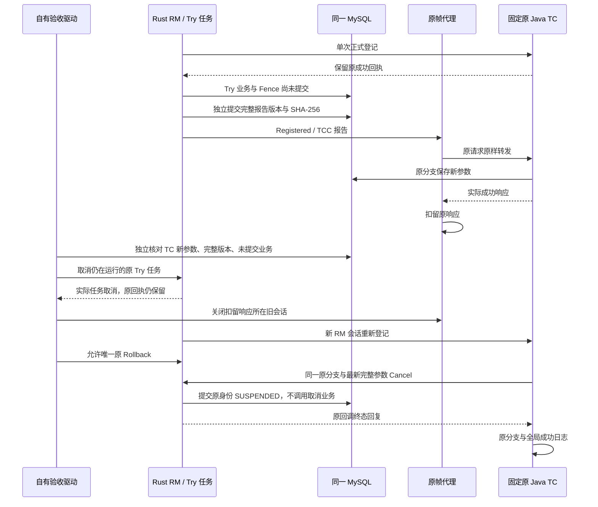

# 动态报告与原 Java TC 故障联合验收（选定矩阵已验收）

规格事实源延续 [TCC 契约](../../../phase-2/tcc-contract.md)。本次不修改生产 Rust 模块、Java 原事务协调逻辑、019/020 迁移、Java Undo 或原 AT/XA 数据格式；扩展真实夹具与独立证据核验；沿用已封存的鉴权扩展，不覆盖事务协调器类。最终源码对应的批次和摘要见 [ledger](../../tcc-dynamic-original-tc-faults.json)。

| 原 TC 故障 | 双版本事务数 | Try 与原二阶段结果 |
|---|---:|---|
| 精确重复一份原回调 | 12 | Try 已提交；原 Confirm/Cancel 业务各执行一次 |
| 丢失原终态回复并关闭会话 | 12 | 新 RM 会话重新登记；TC 自行重试同一分支和完整参数，无业务重放 |
| 原报告成功响应丢失 | 6 | 保留原回执与类型化 UnknownOutcome；Try 未提交，原 TC Cancel 建立 SUSPENDED |
| 原报告等待中主动取消 | 6 | 调用方先保留原回执，实际取消仍在运行的 Try；原 TC Cancel 建立 SUSPENDED |

每项覆盖延迟、立即与原字节精度路径。回调两种故障各包含原 Commit/Rollback，报告两种故障由唯一的原 Rollback 结束，合计 36 笔原全局事务。立即报告失败/取消发生在首个报告等待中，因此版本只包含当时的完整参数，不包含业务尚未执行的后续 final 字段。

报告丢失和取消不表示 TC 未处理请求。此矩阵先观察原 TC 的真实成功响应及其已保存的新参数，随后才丢失响应/取消任务。取消场景扣留的响应在独立观察完成后随旧连接关闭，未宣称该响应已迟到交付给已取消调用。重连确认和唯一全局结束之间的原始时钟/帧顺序另行核验。

同步 TM 结果可能未决，原结果保持未决；最终必须同时有原 DefaultCore 的分支/全局成功日志、同分支原终态帧、真实 Fence 和业务 SQL。Finished、TC 行缺失、文件日志 Completed 或配置标志均不能单独证明完成。每次报告、登记和全局结束按原关联号及次数验证，不能用客户端重发拼出成功。

原登记与 Fence 的应用数据保持原字节，最新业务参数由完整报告版本与原 TC 回调携带。独立核对全局结束前的 TC 分支行、完整版本及每版摘要；二阶段之后再核对完整清单未变、019 原资源/原实例/原数据/协议 2、实际同方向终态及 DML。已提交 Try 的 Confirm 得到 18（精度专用为 14）；报告未确认的 Try 必须没有业务行，Fence 最终为 SUSPENDED=4，仅有回滚的 Try INSERT 尝试，没有 Cancel 业务 DML。

## 运行与核验证据

本轮同时重跑双 Rust 完整工作区与严格检查，每版 801 passed / 388 ignored、179 个成功摘要；32 个动态分支场景、12 个原 TC 正常动态事务、16 个静态 MySQL、4 个正常/8 个故障静态原 TC、54 个进程/同库恢复场景单独计数。核心 48 次与动态 12 次错误源码实际行为失败继续验证，不把构建失败或初始化超时计作反例。

新代理规则使用封存的真实 V1 帧执行五项规则测试：规范的零长度可选资源、AT 状态拒绝、原成功响应关联、回调精确复制及报告等待释放。它们是夹具测试，不能替代实际原 TC 事务。首次代理错误地把可选资源 None 当成 -1 长度，真实生产者的规范编码为零长度；初次不完整批次保留为诊断，修正后重跑。原组合配置拒绝的 RED 也只证明夹具缺少组合入口，不计为生产故障。

一次动态回归在原三秒固定头等待处超时；一次反例批次发生 Windows 过程宏 DLL 链接错误，均已清理所属数据库并保留诊断。替代批次未放宽断言；反例构建只复用不含可执行文件/DLL/PDB 的缓存并限制编译并发，执行副本与实际构建产物逐项绑定。完整替代结果以 ledger 为准。

## 完整计划仍开放

本矩阵未强杀原 TC/动态写入者，未重启/强杀报告数据库，未关闭动态并发/跨实例拓扑及配置变更、安全权限、保留清理、负载与运维门禁。静态进程/数据库回归不替代这些动态故障。Java 任意对象/反射注解、AT/XA 剩余门禁及 Phase 5–7 继续保留；不能据本增量宣称完整 TCC 或总计划完成。

最终独立核验拒绝 2326 项证据削弱，其中新增动态原 TC 故障 1066、原 TC 静态故障 104，其余来自本轮重新绑定当前源码的核心/报告/进程回归。实际命令、验证器和原输出均在 validation 批次。自然原 TC 重试若有重叠，另按真实关联和关闭时序增加反例，不把未答复请求算作成功。
