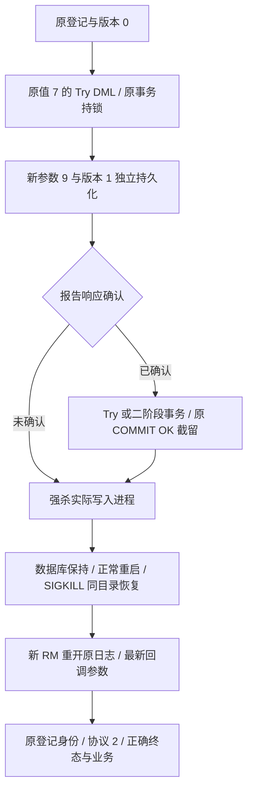

# 动态报告：写入进程强杀与同库恢复

双 Rust × 数据库持续运行/正常重启/SIGKILL 同目录恢复 × 十个事务边界，共 60 场景。正式 RM 使用自有原 V1 测试对端，不能计为 Java TC 同时崩溃证明。生产源码、迁移、Cargo 及 Java Undo 格式与 e243a2cf 一致；只扩展故障夹具和核验。

阶段包括报告已落盘但响应未确认、报告确认后 Try 未提交、TRIED 后 Confirm/Cancel、Try/Confirm/Cancel/空 Cancel 的真实 COMMIT OK 截留，以及 Confirm/Cancel DML 未提交。空 Cancel 独立保留无报告清单路径，不能补造来源。未提交业务被原事务回滚；确认后的二阶段使用新参数 9，实际 Confirm 结果为 18，原 Fence 和日志仍绑定登记参数 7。已提交终态不能重放业务，未提交动作与恢复动作的 DML 分开核对。

父夹具持原生子进程句柄，外层控制器独立观察其存活及非零退出；实际 NOWAIT 锁错误或原 COMMIT/OK 证明事务边界。同一容器/挂载目录/UUID、原报告 0/1 和逐字节 SHA-256、协议 2 的原登记 Fence、旧 Pending/新 Completed 的日志 CRC 与前后 general_log DML 联合核验。原报告请求保持 Registered/TCC，未确认报告时不发送成功回执；不把清单存在当作 Try 提交。

1312 项证据削弱被拒绝，覆盖进程、锁、原包、实例、版本丢失/改写、原 Fence、报告确认标志、日志和业务。静态共享夹具回归 18 项通过；工作区每版 801 passed / 394 ignored，179 个成功摘要及严格 Clippy 通过，ignored 原生场景由运行器显式选择执行。详见 [机器 ledger](../../tcc-dynamic-process-database-recovery.json) 和 [最终验证](validation_dynamic_process_20261128_final)。

最初九阶段单版本运行、严格检查暴露的重复模块、主动停止的早期矩阵及测试对端提前 3 秒超时的运行仅作诊断。停止时已核对自有可执行路径和进程句柄；观察文件被仍运行的子进程占用导致复制失败后，额外核对并关闭自有子进程和容器，记录 aborted-cleanup。最终运行器保证复制失败也先清理容器，复制不完整不得通过。模块共享修正后，明确对端读取等待长于 RM 原有回调预算，记录并限制同一原分支的显式可重试失败与最终成功；生产超时不变。最终 60 场景的首次恢复及重复回调均明确成功，共 120 个成功响应，未观察到可重试失败；测试对端保留的重试分支不计为本轮实际失败响应覆盖。随后重新核验上述完整矩阵。

本项只补齐选定动态进程/数据库恢复门禁；原 TC 联合崩溃、并发/拓扑、生产权限/保留/负载/运维与全计划仍开放。
