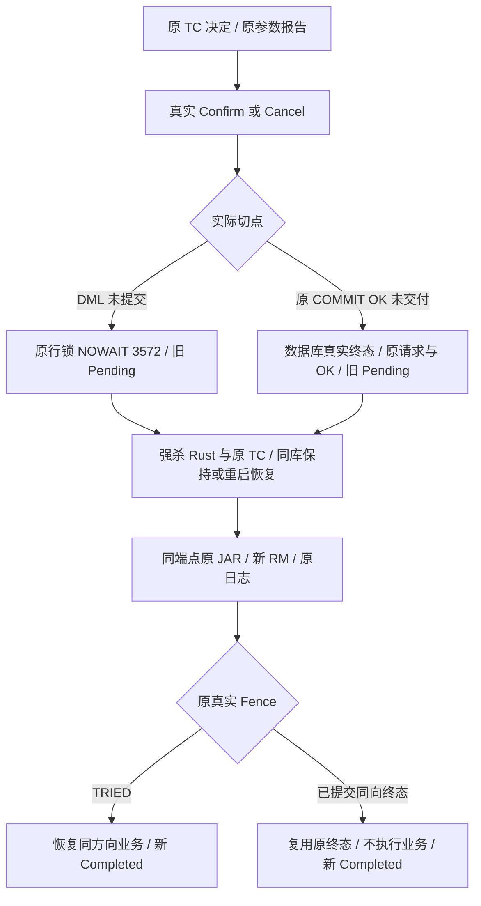

# 原 TC：二阶段内部联合强杀

双 Rust × 三种动态上下文 × Commit/Cancel × 两个内部切点 × 三种数据库模式，共 72 笔原 Java TC 全局事务、144 次原 TC/Rust 进程强杀。新 RM 继续使用原日志、登记身份、最新报告参数及原 TC 的同分支重试，原全局 End 每笔只有一次。生产 API、协议、迁移、Cargo 和 Java Undo 格式未改。

未提交切点在真实业务 DML 返回后保持同一事务，以独立原行 NOWAIT 错误 3572 证明锁仍在；切点及双进程退出后保持 TRIED/原业务值，恢复时只提交同一方向。原 general_log 分开记录旧回滚尝试与新恢复动作，两次实际 DML 只有新动作提交。成功响应切点只扣留真实 MySQL 原 COMMIT 的原成功包，独立 SQL 必须已经看到 COMMITTED/ROLLBACKED 和最终业务；重启后业务 DML 必须为空。完整协议包、请求序号、匹配命令次数和两份旧 Pending/新 Completed 的原身份日志 CRC 一并核验。

三种数据库模式分别持续运行、正常停止重启及 SIGKILL 后启动原容器同目录。原实例 UUID、TC 持久决定、原 TCC 分支与完整参数、连续报告版本及每版 SHA-256 在旧拥有者退出和数据库恢复前后相等。新 RM 不发 Begin、业务分支登记、报告或 End；最终以新 TC 的原分支/全局成功日志、原关联终态响应和真实业务/Fence 联合证明，保留原登记数据和协议 2。

每个内部切点各 36 笔，全部通过。独立核验拒绝 3,816 项证据削弱，包含原锁证据、原 COMMIT/OK、错误提交序号、进程退出、端点/资源、持久决定、同时改写版本观察但不改正确摘要、旧/新日志 CRC、业务重放和伪造终态。双版本各 801 passed / 395 ignored、179 摘要及严格 Clippy 通过；选定原生恢复函数显式执行。原首次回调未交付切点的双版本双方向 4 笔回归及 11 项对端/文件控制检查通过。48 项未变化核心源码的历史反例重新核验，不计作本轮新源码变异。

最初单笔 COMMIT OK 运行与共享夹具接口告警保留为诊断；严格检查修正后重新运行完整矩阵。持锁与截留都由测试夹具保持，使用明确的受控等待预算，未修改生产超时；代理未收到预期原包时会有界关闭。原 JAR/协调器不改，认证覆盖仅限原本地夹具。源码、原始帧、独立 SQL、原生进程句柄及容器生命周期见 [最终核验](validation_joint_internal_20261128_final) 和 [机器 ledger](../../tcc-original-tc-internal-joint-recovery.json)。

本项关闭选定二阶段内部联合切点。Try/报告及未确认报告的更多联合切点、配置并发/拓扑、生产权限/保留/负载/运维、AT/XA 与 Phase 5–7 继续开放。

最终核验记录：一笔强杀场景中，原 TC 的第二次重试在强杀授权后约 1.3 ms、原 Rust 被独立句柄观察为退出前到达。授权不等于退出；校验分别要求首次回调早于授权、所有旧回调早于实际退出观察，并逐笔增加两项时间边界反例。未修改原始证据或重跑替换该场景。
