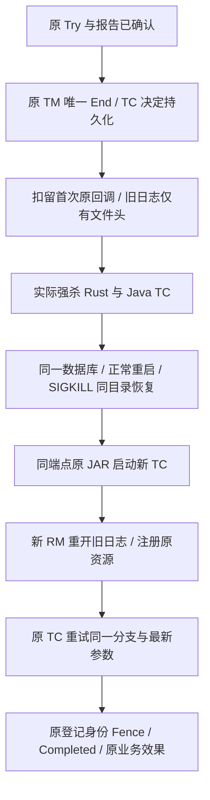

# 原 Java TC 与 Rust 客户端联合崩溃恢复

双 Rust × 三种动态上下文（延迟、立即、原字节精度）× Commit/Cancel × 数据库持续运行/正常重启/SIGKILL 同目录恢复，共 36 笔真实全局事务。每笔同时强杀原 Rust 客户端与原 Java TC，72 次原进程退出均有独立保留的 Windows 句柄观察。原 TC 的唯一决定已落盘，首次回调被原字节扣留、从未交给旧 RM。

旧 TM 随原 Rust 进程退出，原调用没有可交付结果。恢复端只启动正式 RM，接收原 TC 的同分支回调；不创建新全局事务、不重新登记业务分支、不发送报告或全局 End。原资源/应用/凭据范围、TC 端点、全局 XID/BranchId 和完整最新参数均由原帧比较。最终由新 TC 的原分支/全局成功日志、关联终态响应、原 Fence 与实际业务共同证明；TC 行清理只作联合证据。

原数据库的实例 UUID、挂载目录和镜像、TC 决定 2/4、原 TCC 分支、报告连续版本/原字节 SHA-256、原协议 2 Fence/TRIED 和 Try 业务在双拥有者退出及数据库恢复前后逐项相等。旧日志只有 SRMJNL01，新日志保持原登记数据，仅一次 Pending/Completed，逐条 CRC 校验。general_log 证明原 Try INSERT 一次，恢复后的 Confirm UPDATE 或 Cancel DELETE 一次；精度模式结果 14，其他提交结果 18。重启后的原 DefaultCore 从固定原 JAR 载入，原协调器未修改；认证覆盖仅为既有本地夹具，限定三个允许文件，不宣称生产认证验收。

独立核验拒绝 1,584 项证据削弱，包括消除进程退出、改变端点/资源、伪造切点、重发 End、改写原参数或结果、同时改写三份版本但保留错误摘要、损坏日志 CRC 和移除原 TC 终态日志。11 项对端/控制文件检查通过，其中 Windows 独占文件句柄验证了同一发布文件的有界读取，完整状态文件也不能替代活生产者。工作区每版 801 passed / 395 ignored、179 个成功摘要及严格 Clippy 通过；恢复函数由运行器明确执行，未将 ignored 当作通过。

最初的单笔 Commit 联试与观察器退出、文件共享访问诊断均保留，不计入最终 36 笔。预期连接重置仅在新鲜的显式强杀标记之后被记录，绑定原两个 PID、QPC 时序和标记摘要；未知错误继续失败。文件共享冲突只重读同一已发布字节，不重启生产者或生成切点。最终三个矩阵各自封存源码、进程、SQL、帧和容器清理证据，见 [最终核验](validation_joint_crash_20261128_final) 与 [机器 ledger](../../tcc-original-tc-joint-crash-recovery.json)。

本轮未改生产 API、协议、迁移、Cargo 或 Java Undo 格式。选定联合切点完成；Try/报告/二阶段内部更多联合切点、配置并发/跨实例拓扑、生产门禁、AT/XA 和 Phase 5–7 继续开放。
