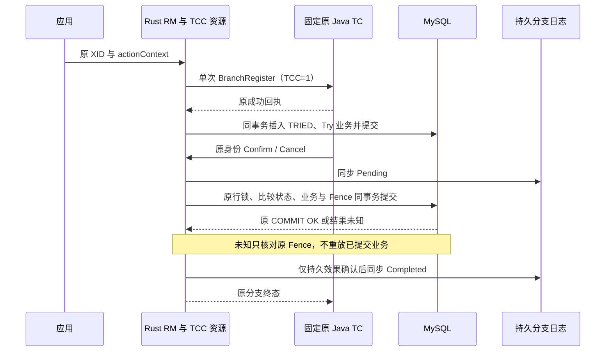

# 正式 TCC 与 MySQL 同事务 Fence

事实源：[TCC 契约](../../../phase-2/tcc-contract.md)。最终目录、目录摘要和验收状态见 [machine ledger](../../mysql-tcc-managed.json)。这是显式 `tcc` feature 的受限 InnoDB 执行增量，不关闭完整 TCC 或生产门禁。

`TccBusinessAction` 提供 Try/Confirm/Cancel，业务只取得参数化单条 DML 的事务能力。`MySqlTccResourceManager` 保留正式 ResourceClient 单次登记签发的原回执，原动作名、XID、BranchId、应用信封和 `lock_key=None` 不变。019 显式创建独立 Fence；运行时不建表、不迁移、不删终态。Java Undo、原 Fence、AT/XA 结构均未修改。

事务在首个 await 前移出业务作用域；任何失败或取消都不能再提交，即使业务捕获 DML 错误后返回 true。目标必须为当前物理 InnoDB 基表，无触发器或双向外键；内部表和非 DML 被拒绝。Fence 检查精确列、主键/索引、当前实例/schema、原身份和提交持久性；业务和 Fence 只在同一 COMMIT 后可见。

空 Cancel 只接受正式 RM 回调能力，经文件 Pending 后唯一插入 SUSPENDED；手工裸身份 apply/recover 缺行保持 Unknown。晚到原回执被原屏障拒绝，已有 Fence 不能再次 Try。恢复持同一原行锁排除旧事务，再按真实 TRIED 或同方向终态决定执行/复用；相反终态不会换向。

Try 按 ADR-0008 分开 Refused、UnknownCommit 和带发送边界的 Deadline。Refused 仅表示本次没有发送 COMMIT，不否定别的尝试或原 Fence，也不授权重放。COMMIT 发送事实在最终实例/持久性检查后置位；响应丢失或取消不能回退该事实，真实原回执仍可取得。

| 每个 Rust 版本的真实 MySQL 场景 | 验证内容 |
|---|---|
| 正常两方向与重复 | Try 后 TRIED 与业务同时可见，重复 Try 拒绝，重复回调不再执行业务，反方向 Unknown |
| 业务 false / 捕获事务错误 | Try 和 Fence 不部分提交；Confirm false 回滚后由新资源恢复原 TRIED |
| 回调先于登记响应 | 原 Cancel 生成 SUSPENDED，原回执晚到后拒绝 Try；手工缺行不造屏障 |
| 原身份与当前结构 | 五类行篡改、额外索引/默认值、MyISAM 和触发器均不执行业务；恢复原条件后同一分支完成 |
| Try/Confirm/Cancel COMMIT OK 丢失 | 实际原成功包被扣留，业务/Fence 已生效；原回执保留，二阶段旧 Pending 重开后由新 RM/数据源完成，不重放业务 DML |
| 实际持锁 Try 与 Cancel | 独立观察到 InnoDB 行锁等待；未提交 Fence/业务不可见；释放后原 Cancel 完成并拒绝迟到 Try |

固定原 Java TC 在两版 Rust 上各运行完整 Commit/Rollback，要求初次全局响应明确 Committed/Rollbacked。独立解析原 V1 帧，核对 TCC=1、原长整数编号、精确动作/上下文、无锁键、无 AT PhaseOne_Done、原分支 5/8 和全局 9/11；独立 SQL 核对 Fence、业务和 TC 清理。general_log 中 Try 和二阶段业务各一次；唯一 XA 观察是运行器自己的只读 XA RECOVER，不存在 TCC 原生 XA 写入。

最终双版本共十二项 MySQL、四项原 TC 全局事务；134 项语义证据削弱被拒绝。核心七类生产源码反例仍实际拒绝十四次。完整工作区各 791 passed / 380 ignored，177 项成功 harness 汇总，TCC/XA/MySQL 严格 Clippy 通过。ignored 的现场用例由独立运行器明确执行，忽略本身不算通过。

诊断保留：初期锁文件/API 编译失败不计行为证明；`mysql-red_20261128_004701_fd78d0ec` 才是已真实登记但缺少原子执行的红灯。中间批次在错误分类和 DML 审计补强前，不能替代最终证据；初始 Java 观察字段曾误写 TCC=2，生产线缆始终为正确的 1，独立帧校验拒绝该证据，最终改为协议枚举显式映射并全部重跑。最终只使用 ledger 指定目录。

剩余门禁包括完整登记拒绝/丢失/取消矩阵，原 Java TC TCC 重复/重连/故障，TCC 写入进程和数据库崩溃恢复、动态上下文报告、保留/清理/权限/负载与运维。AT/XA 剩余门禁及 Phase 5–7 继续开放。
