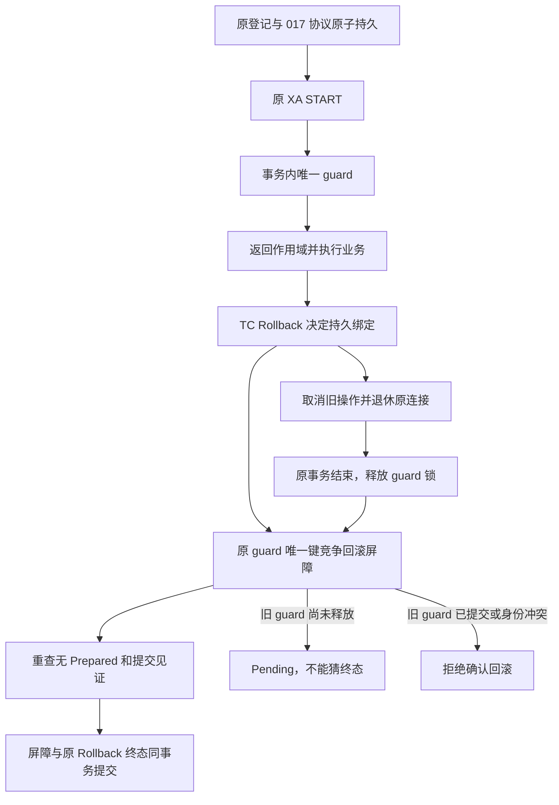

# 旧 ACTIVE 作用域的资源围栏

后续 [正式早回滚交接](EARLY_ROLLBACK.md) 已推进早于原登记响应的回调；下文保留本阶段的历史边界。

事实源：[XA 契约](../../../phase-2/mysql-xa-contract.md)。固定最终目录及结果见 [machine ledger](../../mysql-xa-active-guard.json)。

017 在原唯一登记控制事务中明确登记新 guard 协议；旧分支不被自动回填。018 是同一原身份的事务内 guard。新生产者在原 XA START 后、任何业务或向调用方返回作用域之前，必须唯一插入 phase=0/completed=0 guard。开始门闩下再次验证当前物理结构，防止登记控制事务结束后的结构变化进入原生开始路径。原 guard 随业务一起持有、提交或回滚。

作用域持有可取消的独占会话槽。250ms 观察间隔的监视器通过独立、有绝对期限的连接读取原实例/登记决定；只持弱引用，普通观察期间不延长原业务连接寿命。决定绑定、原记录不再匹配或观察失败时，监视器封闭该槽。等待门闩及在途业务/Prepare 都可取消，错误保留原真实回执；空闲时直接退休本库实际持有的连接，不按连接编号远程 KILL。健康 phase=0 的作用域继续允许业务，监视器不能授予 TC 完成权限。

回滚屏障是 phase=2/completed=1 的持久唯一键。其成功插入必须等旧 guard 的事务结束；原已提交 guard、错误身份、错误结构或不完整屏障均拒绝。取得屏障后再次确认无原 Prepared 和提交见证，才将屏障与原终态同事务提交。迟到的原 guard 插入被该键阻止，因此不能继续到业务阶段。缺新协议标记时仍 Unknown，不把旧分支套入新证明。已 Prepared 的原事务继续走既有 Prepared/结束意图路径；不能靠关闭原连接宣称 Prepared 已回滚。

选定现场包含：保留已经插入和更新真实业务的旧 ACTIVE 对象，以独立数据源/管理器处理正式回调；健康作用域跨过两次实际监视查询后仍能更新，回滚后原对象的 DML/Prepare 都拒绝。独立 SQL 核对控制终态和 guard 屏障、业务回滚、Prepared 集合；general_log 核对只有一次 START，没有 END/PREPARE/ROLLBACK，没有远程 KILL。另有缺协议登记、六类登记字段篡改、六类 guard 冲突（含已提交 guard）、额外索引拒绝；修复原登记并清除测试冲突后由真实屏障完成。正式客户端、原 Java TC 两方向及连续 PREPARE/ROLLBACK OK 丢失仍回归。

历史诊断保留：红测试在实现前得到状态 9，不能完成活跃作用域；实现后的中间矩阵发现新 guard 证明会替代旧意图路径，故兼容性负例显式移除新协议登记，继续要求旧路径缺证据 Unknown。一个并行运行中的旧意图检查触发原故障夹具 750ms 期限；最终存储负例使用独立正常期限管理器，响应截留的原操作仍保持短期限。最终选定目录以 ledger 为准。

仍未完成完整 XA/生产门禁：被暂停或网络分区的旧会话尚未释放 guard 时保持 Pending，不提供任意远程会话强制清理；早于原登记的回调围栏、进程崩溃、并发和控制 COMMIT 丢失矩阵、监视器规模/性能/生命周期观测、部署/最小权限/保留和恢复拓扑继续验收。AT、TCC、Phase 5–7 总计划不因此关闭。Java Undo 格式和旧 Undo 记录不变。
