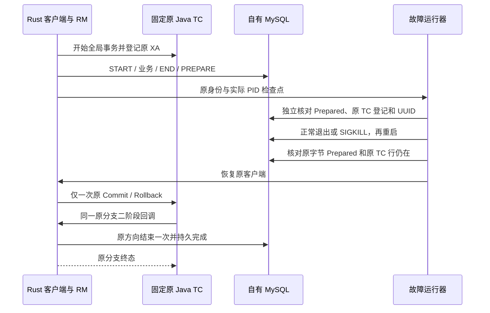

# 原 Java TC 事务跨 MySQL 重启恢复

事实源：[XA 契约](../../../phase-2/mysql-xa-contract.md)。最终证据及摘要见 [machine ledger](../../mysql-xa-java-database-recovery.json)。这是现有恢复能力的故障验收，不新增生产协议、公开 API 或迁移。

固定原 Java TC 使用数据库 Session Store，正式 Rust RM 登记原 XA 分支并完成真实 Prepare。客户端在该检查点暂停，运行器核对实际客户端 PID、Prepared 原字节、原 TC 全局/分支行、MySQL UUID 和隔离容器所有权。正常停机使用自有容器的 Docker stop；崩溃使用同一容器的 SIGKILL，必须实际退出且返回 137。两种情况均在原数据目录、同一容器和实例 UUID 上重启。

原 TC 与 RM 进程继续运行，客户端只替换已经关闭的独立观察连接，不重建身份、不重新 BranchRegister、START、业务或 Prepare。重启前后原 TC 登记和 Prepared 必须逐字节相同；最终必须联合确认线上原分支回包、固定源码的原 TC 分支/全局成功日志、原业务与控制行、Prepared 及 TC 清理。未知初次 TM 结果继续保留未知，不能从 Finished 推断成功。

数据库恢复后原 TC 可以自然重试，两个请求也可能在前一回包到达前交叠。校验器逐个核对请求/响应关联和同一原身份，要求每个实际终态回包正确；原生结束次数仍须严格为一次。不能把“回调恰好一次”作为故障恢复的前提。

重启前快照和重启后 TABLE general_log 分开保存，独立校验串接两段真实观察，要求原 XA START/END/PREPARE/COMMIT 或 ROLLBACK 各一次。TABLE 日志配置在每次重启后显式恢复，不能因临时全局配置丢失而以空日志证明无重放。校验器另对 Prepared、UUID、原 TC 行、退出状态、原包、日志和物理结果执行语义削弱检查。

最终双版本八例通过，实际收到九个回调，Rust 1.99 崩溃回滚例包含一次原 TC 自然并发重试；112 项语义削弱被拒绝。另回归四项正常原 TC 事务，两版工作区各 785 passed / 372 ignored，严格 XA/MySQL Clippy 通过。上述结果只证明本页列出的同实例恢复场景。

诊断保留：`java-fault_20261127_235118_17ed3480` 为加入检查点前的预期失败；`java-fault_20261127_235247_f6e4ca05` 是 Rust 1.99 崩溃试跑；`java-fault_20261127_235434_a60a98b3` 是日志配置补强前的批次。后两者的客户端结果不能替代完整命令审计，因此不作为最终无重放验收。最终仅使用 ledger 指定目录。

本轮范围为同一 MySQL 实例的数据目录恢复。丢失数据目录、主从切换、实例变更、权限、恢复拓扑、负载和生产运维，以及完整原 TC 故障矩阵、AT/TCC 和 Phase 5–7 继续开放。
