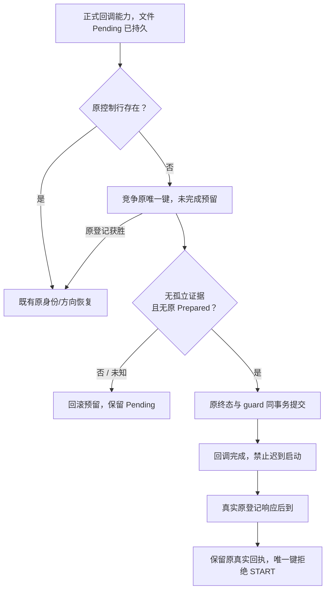

# 早回滚回调与迟到登记的持久交接

规格事实源：[XA 契约](../../../phase-2/mysql-xa-contract.md)。固定最终证据见 [machine ledger](../../mysql-xa-early-rollback.json)。本增量复用现有 RM 回调观察接口和 014/018，不增加迁移或公共协议类型。

只有正式 RM 连接整批校验后签发的 BranchCallbackReceipt 才能进入早回滚观察器；私有持久交接方法也直接要求该受控类型。文件 Pending 先于观察器写入。手工 apply/recover/dispatch 在缺记录时仍 Unknown，不签发早屏障，不转换或补造 RegisteredBranch。

已有原控制行时，观察器只交回正常完整身份/方向检查。缺原控制行时，先在控制事务竞争原唯一键，创建尚未完成的回滚预留；再检查原提交见证、生产者证据、guard 协议登记和 guard 都不存在，并实际确认原三分量 Prepared 不可见。只有这些条件成立，才能插入 guard 屏障、确认预留终态，并提交同一控制事务。任何孤立证据、未知观察、失败或取消都不能提交完成记录。原登记若先获胜，重复键只释放本次锁，再走正常 ACTIVE/Prepared 恢复，不能被解释为回滚成功。

否定记录只阻止原分支继续启动，不表示拿到了 BranchRegister 成功回执。迟到客户端仍从真实响应取得原 XID、原 long BranchId 和原可选数据；本地启动因唯一键拒绝，回执克隆也不能重启。该证明依赖受管理登记记录永久保留和独占协议，不能用于绕过受管理路径的外部写入或管理员删除控制数据。早 Commit 不套用空回滚证明，继续要求原提交结果证据。

双版本每版十二项 MySQL 现场包括：早回调先完成、原响应后到拒绝、克隆拒绝、手工入口无控制行、独立新管理器终态和反向拒绝；三个原登记/回调竞争子场景，保持原可选应用数据，只允许可重试未决或最终回滚完成；四种孤立控制记录和一个持有真实未提交业务的 orphan Prepared，第一回调均不能确认空回滚，失败预留无可见控制行、文件仍 Pending，明确修复后才完成并拒绝迟到启动。独立 general_log 核对早屏障不发送 XA START/END/PREPARE/ROLLBACK，竞争分支最多各一次 START，无迟到业务；orphan Prepared 的显式清理命令顺序独立核对。每版本十八项来源、孤立数据和竞争结果的证据削弱被拒绝。

红测试在实现前观察到早回调状态 9，实现后为 8。最终源码封存、原始包、独立 SQL、正式原 Java TC Commit/Rollback 和工作区/严格 Clippy 的实际结果均由 ledger 固定；ignored 测试不单独计作通过。

完整 XA Gate 和总计划仍未关闭：真实进程崩溃、暂停/网络分区、强制清理、控制 COMMIT 响应丢失和更完整并发/原 TC 故障矩阵，以及部署/权限/规模/保留/恢复拓扑继续验收。AT、TCC、Phase 5–7 继续推进。Java Undo 格式与旧记录不变。
