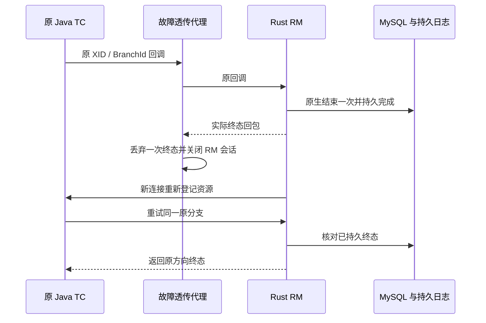

# 原 Java TC 回调重复投递与 RM 重连

事实源：[XA 契约](../../../phase-2/mysql-xa-contract.md)。最终执行目录、目录摘要及验证结果由 [machine ledger](../../mysql-xa-java-callback-faults.json) 指定。

固定 Java `cba73e180fd8896a99df6415b859d275122feaa7` 的原 TC 构建产物，使用原数据库存储和 MySQL 8.4.13。复用已有透明故障代理，对真实 XA 分支的 Commit/Rollback 各注入两种故障，在 Rust 1.99 和 1.85 上合计执行八个用例。生产协议、公开 API、数据库迁移、Java Undo 格式及旧记录均未修改。

| 故障 | 实际投递 | 验证结果 |
|---|---|---|
| 重复回调 | 同一原回调精确复制两次；扣留第一原终态回包，收到字节相同的第二回包后仅释放第一包一次 | 原分支与全局完成，原生结束和业务没有重放 |
| 终态回包丢失并重连 | 第一次真实终态回包不投递，关闭该 RM 会话；新连接重新登记；原 TC 重试同一分支 | 重试返回同方向终态，原生结束和业务没有重放 |

每例只调用一次 TM End，不做状态查询、客户端 End 重发或从 `Finished` 推断成功。重连下初次 TM 请求可以超时，证据以 `initial_global_status: null` 保留客户端未决。夹具对最终 TC 结果另行要求：原始线上分支终态、固定源码的分支与全局成功日志、原数据库方向和完成标记、实际业务数据、空 Prepared 和原 TC 三张表清理同时成立。这项验收不会让 SDK 将未知结果改报成功。

独立校验器解析原始包身份、请求关联、空可选字段、两次响应的具体投递动作及新会话登记，按原 XID/BranchId 核对 general_log 中 START/END/PREPARE/结束各一次。源码封存与目录摘要另行核对；语义削弱测试绕过摘要层直接改写证明输入，防止仅靠哈希拒绝掩盖校验遗漏。

同时回归原 TC 正常两方向，仍要求初次全局响应明确 Committed/Rollbacked。两版工作区测试各 785 passed / 372 ignored，严格 XA/MySQL Clippy 通过。

`java-fault_20261127_232052_ba665c46` 为格式整理前 Rust 1.99 重连试跑，仅作诊断保留，不能替代 ledger 指定的最终双版本证据。完整原 TC 故障/并发矩阵、数据库故障、恢复拓扑、生产验收及总计划继续开放。
