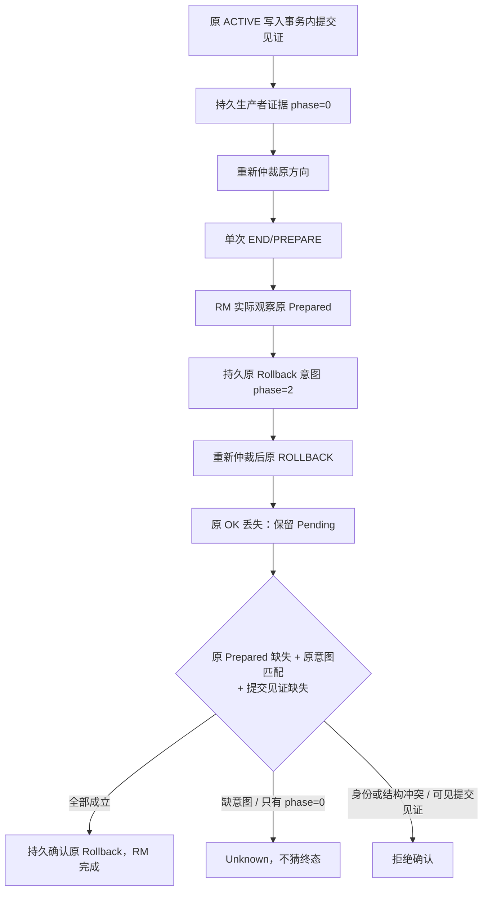

# Prepared 回滚结束意图与连续响应丢失恢复

后续 [017/018 ACTIVE 资源围栏](ACTIVE_GUARD.md) 已推进可运行旧作用域的取消/屏障；暂停或分区会话仍不假定已终止。以下保留本阶段的历史结果。

规格事实源：[XA 契约](../../../phase-2/mysql-xa-contract.md)；最终证据目录和摘要见 [machine ledger](../../mysql-xa-prepared-rollback.json)。

016 显式创建生产者/Prepared 结束意图表。生产者在原 ACTIVE 物理连接实际写入 015 提交见证后，先持久保存精确原登记的 phase=0/completed=0 证据，再重新获取原分支门闩，确认方向仍未绑定，才发送单次 END/PREPARE。该记录不表示 Prepared 已完成，更不表示业务结果。

RM 持原分支门闩，真正观察完整原三分量 Prepared 后，才允许将原证据升级到 phase=2/completed=0；先确认控制 COMMIT，再重新取得原门闩和实际状态，随后执行原 ROLLBACK。不同管理器共用数据库决定，不能换向或重新 START。

缺行恢复依赖完整证据组合：此前进入 Prepared 的原事务不能由受管理生产者重新开始，原见证在该 XA 内，原持久决定是 Rollback；结束后实际读不到提交见证，才能排除 Commit。没有结束意图、仅有生产者 phase=0、错误身份/结构或可见 Commit 见证均不能确认。旧分支没有 016 生产者证据时，仍只依靠本次明确原生 ACK；丢失 ACK 不补造证明。该推理要求受管理身份独占和原物理实例/schema，不能套用于管理员删除证据、恢复拓扑变化或绕过受管理 API 的写入器。完整生产权限和外部写入边界继续验收。

最终现场每个 Rust 版本执行九项受管理 MySQL 用例。新故障链使用两个透传代理，在同一原 XA 实际截留 PREPARE OK 和 ROLLBACK OK：Prepare 错误保留原真实回执，原生产者证据跨越第一次响应丢失；RM 首次回调保留 Pending，原回滚意图跨越第二次响应丢失。新数据源和新管理器恢复同一原分支，随后原 RM 回调完成。独立 general_log 与原始包证明 PREPARE 和 ROLLBACK 各一次；业务、提交见证为空，控制行 phase=2/completed=1，原意图 phase=2/completed=0，无 Prepared 剩余。

每版本六项意图字段篡改、额外索引、仅 phase=0、删除意图、插入冲突 Commit 见证都不能确认终态；恢复原字段后完成原回滚。每版本十五项证据削弱被独立校验器拒绝。红测试在实现前精确观察第二回调仍为状态 9；实现后为 8。正常原 Java TC 双版本 Commit/Rollback 继续验证完整原登记和原回调；全工作区和严格 XA/MySQL Clippy 的实际结果记录在 ledger，忽略测试由独立现场工具执行。

未 Prepared 的 ACTIVE/IDLE 旧会话仍需要实际围栏；仅持久生产者记录不能当作会话已结束。真实进程崩溃、并发回调、终态控制提交丢失、原 TC 故障矩阵、部署/权限/证据保留与 AT/TCC/Phase 5–7 继续开放。本增量不关闭完整 XA Gate 或总计划，不改变 Java Undo 格式与旧 Undo 记录。
