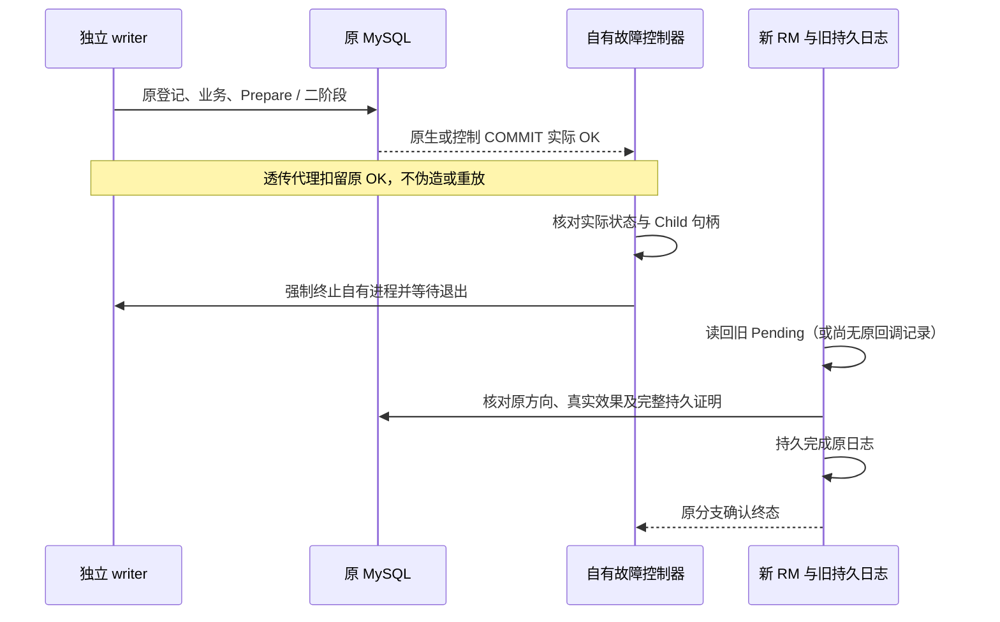

# 真实写入进程崩溃与双层响应丢失

事实源：[XA 契约](../../../phase-2/mysql-xa-contract.md)；最终目录和摘要见 [machine ledger](../../mysql-xa-process-crash.json)。本增量补充现有机制的实际故障验收，不新增运行时协议、数据库迁移或第三方依赖。

每个 Rust 版本实际启动九个独立 writer。writer 从正式 RM 客户端取得原回执，在原数据库完成生命周期动作，再写出可核对的检查点；不会序列化或补造 RegisteredBranch。父进程核对检查点 PID 与实际 Child 句柄、原 XID/BranchId/资源、真实 Prepared 和 NOWAIT guard 持锁状态，随后强制终止该自有进程并等待退出。新 RM 使用独立数据源，重开原日志并处理同一原分支。无响应场景先使用另一份日志，在旧 writer 仍存活且 guard 仍锁定时验证 Pending，再实际终止 writer 并继续恢复。

| 检查点 | 终止前实际状态 | 新 RM 验证结果 |
|---|---|---|
| enlist 后 | 原 guard 已持锁，没有业务 | 实际释放后取得回滚屏障 |
| ACTIVE 业务后 | 业务未提交，guard 持锁 | 业务随原进程连接结束回滚 |
| Prepare 后 Commit | 原 Prepared 已实际存在 | 进程退出后仍可见，原 Commit 一次 |
| Prepare 后 Rollback | 原 Prepared 已实际存在 | 进程退出后仍可见，原 Rollback 一次 |
| 原生 COMMIT OK 截留 | 业务已提交，控制行尚未完成，旧文件 Pending | 提交见证恢复，不重复原生命令 |
| 原生 ROLLBACK OK 截留 | 业务已回滚，旧文件 Pending | 原回滚证据恢复，不重复原生命令 |
| Commit 终态控制 COMMIT OK 截留 | 数据库终态已完成，旧文件仍 Pending | 重读数据库终态并完成旧日志 |
| Rollback 终态控制 COMMIT OK 截留 | 数据库终态已完成，旧文件仍 Pending | 重读数据库终态并完成旧日志 |
| writer 事件循环无响应 | 进程实际存活，原 guard 未释放 | 首次回调和控制终态保持未决；实际终止后才完成 |

故障代理仅接受精确原 XA 命令或控制 COMMIT；有界 CAS 跳过已知的前序控制提交，实际截留终态控制 OK。原请求、原 OK、控制提交前后状态、旧日志、业务和 guard 一起核对，不能只凭“代理已武装”声明边界成立。独立 general_log 按原字节身份核对完整命令序列，特别是两种原生 OK 丢失后没有重放，控制 OK 丢失后也没有重复原生结束。每版本二十三项 PID、检查点、Pending、原包、业务/控制边界等证据削弱被拒绝。

所有终止使用当前夹具实际创建的 Child 句柄，不按外部 PID 操作或发 SQL KILL。失败展开时清理句柄；writer 另有仅作用于自身的 45 秒寿命上限，启动等待有绝对期限。事件循环停住只验证该自有进程无响应场景；操作系统级整进程挂起、真实网络分区和强制远程清理继续验收。

诊断保留：初次编译发现 PathBuf 入口和目标工具链已弃用的原子 API，改为显式路径转换及两版均支持的 CAS；严格 Clippy 检出代理模块重复加载，已改为父模块单次加载并复用。最终证据仅取 ledger 指定目录。

仍未关闭完整 XA 和总计划：原 Java TC 的完整故障/重连/并发矩阵、数据库故障和恢复拓扑、生产权限/部署/规模/保留、AT/TCC/Phase 5–7 等继续推进。本批实际证明了列出的进程边界，不能替代这些验收。
